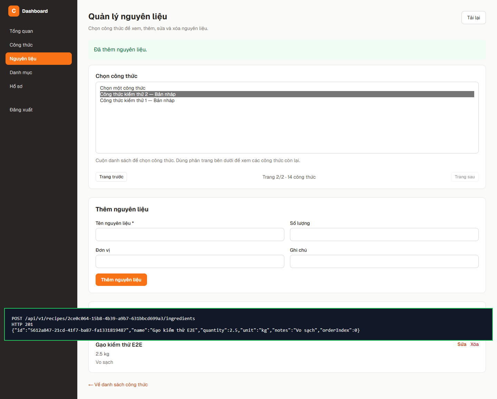
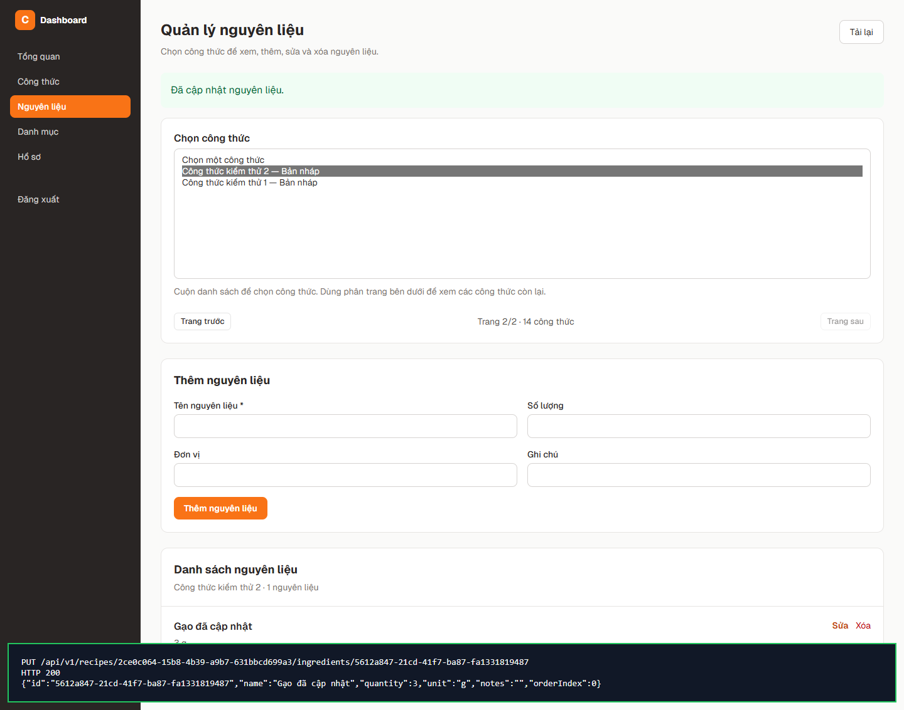
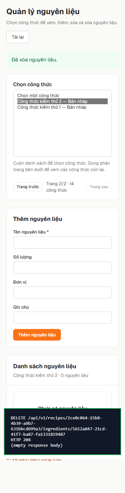
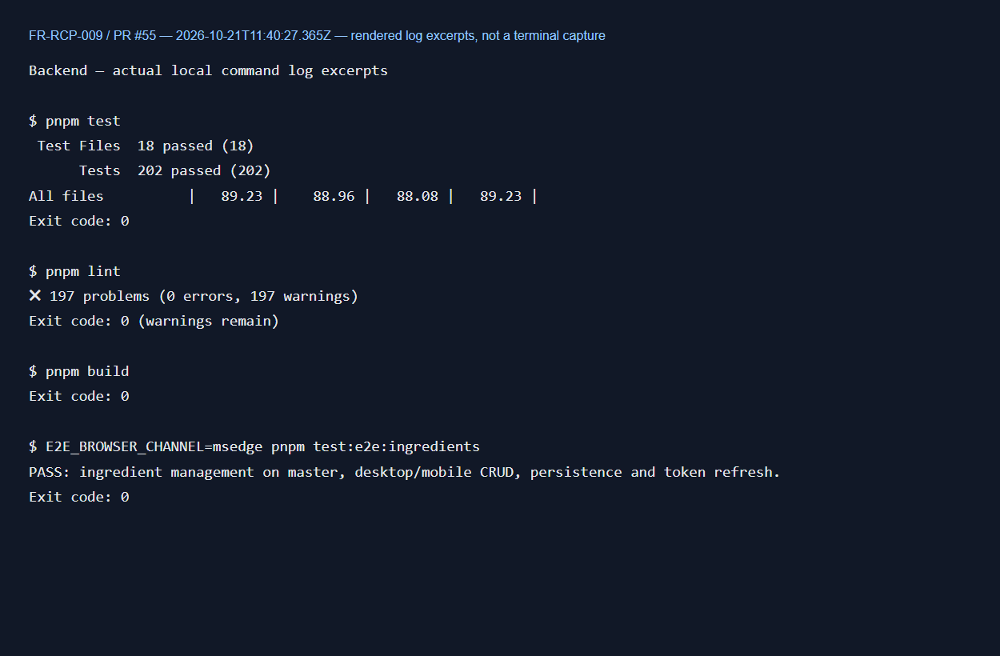
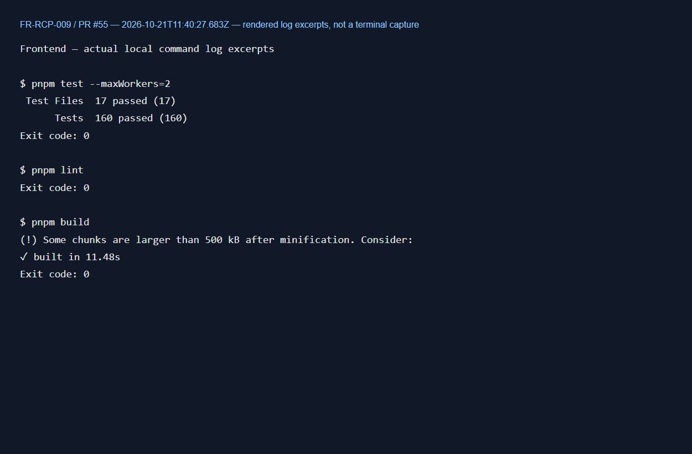

## 1. Thông tin thành viên

| Họ tên | MSSV | Vai trò |
|---|---|---|
| Huỳnh Thành | 2312748 | Backend/Frontend |

---

## 2. FR name

FR-RCP-009 - Add / Update / Delete Recipe Ingredients

---

## 3. Issue name

Issue #25 — FR-RCP-009: Ingredient Management (CRUD)

**Link tài liệu:** [docs/issues/person-3.md](./issues/person-3.md#issue-25--fr-rcp-009-ingredient-management-crud)

**GitHub issue:** [#6](https://github.com/gsb-b60/culinaryblog/issues/6)

**Closes:** #6

> #25 là số thứ tự tài liệu, tương ứng GitHub #6 theo docs/issues/README.md. Issue #6 đã đóng; liên kết được giữ làm ngữ cảnh yêu cầu gốc.

**PR:** [#55](https://github.com/gsb-b60/culinaryblog/pull/55)

**Nhánh:** `feat-frontend-add/delete/fix-ingredient-management` → `master`.

**Nền tích hợp:** master `1ed7022`, bản bàn giao trước review `dee2dfa`.

---

## 4. Mô tả thay đổi

- Tích hợp xem/thêm/sửa/xóa nguyên liệu vào DashboardLayout và Zustand session của master mới; sử dụng API `/recipes/manage`, phân trang 12 công thức/trang, kiểm tra chủ công thức/Admin và validation đầu vào.
- Sửa theo review: đồng bộ `recipeId`/`page` với URL để F5 giữ đúng công thức, xóa trạng thái tải khi chuyển trang để nút Tải lại không bị kẹt, bỏ cập nhật ref trong state updater. Chọn lại cùng công thức không khóa form. Danh sách chọn có vùng cuộn.
- E2E dùng Chromium mặc định, cho phép chọn Edge qua `E2E_BROWSER_CHANNEL`; bổ sung hồi quy lựa chọn/phân trang/F5/mất kết nối với HTTP và PostgreSQL thật. Không giả API hoặc kết nối dịch vụ.
- Thêm JSDoc cho 76 hàm/constructor trong các file source thuộc PR. Docstring coverage khác với test coverage; cần bot tính lại sau push.
- Tách báo cáo, ảnh và script của các chức năng khác khỏi PR. Bản đầy đủ được giữ ở nhánh local `docs/huynh-thanh-review-snapshots`, commit `7f49a92`. Trên nhánh đó đã sửa script `fileURLToPath`, `list.data.items`, mốc master lịch sử và bảo toàn file env; chưa chạy lại toàn bộ snapshot lịch sử.
- Giữ Playwright vì bộ E2E của chính FR-RCP-009 sử dụng thư viện này để kiểm tra và chụp response thật. Các sửa Prisma/SMTP/BULLMQ_PREFIX và CI phục vụ trực tiếp bộ kiểm thử dịch vụ thật, giữ ngưỡng coverage dòng code 80%.

**Các file chính:**

- Backend: [RecipeIngredientQueryHandler.ts](../backend/src/application/handlers/RecipeIngredientQueryHandler.ts), [recipeRoutes.ts](../backend/src/presentation/routes/recipeRoutes.ts), [container.ts](../backend/src/presentation/di/container.ts), [openapi.ts](../backend/src/presentation/docs/openapi.ts), [RecipeRepository.ts](../backend/src/infrastructure/persistence/repositories/RecipeRepository.ts), [NodemailerEmailService.ts](../backend/src/infrastructure/email/NodemailerEmailService.ts), các queue/worker.
- Frontend: [IngredientManagementPage.tsx](../frontend/src/pages/IngredientManagementPage.tsx), [api.ts](../frontend/src/lib/api.ts), [RecipesPage.tsx](../frontend/src/pages/RecipesPage.tsx), [DashboardSidebar.tsx](../frontend/src/components/DashboardSidebar.tsx).
- Tests: [ingredients-master.e2e.ts](../backend/tests/ingredients-master.e2e.ts), [ingredients-master.integration.test.ts](../backend/tests/ingredients-master.integration.test.ts), [real-services.integration.test.ts](../backend/tests/real-services.integration.test.ts), [domain-lifecycle.test.ts](../backend/tests/domain-lifecycle.test.ts).
- CI/docs: [ci.yml](../.github/workflows/ci.yml), [TESTING_REAL_SERVICES.md](../backend/TESTING_REAL_SERVICES.md), [hướng dẫn chạy](./reports/huynh-thanh/CAI-DAT-VA-CHAY.md), [báo cáo review](./reports/huynh-thanh/09-tich-hop-nguyen-lieu-master.md#8-xử-lý-review-pr-55).

---

## 5. Phạm vi

- [x] backend
- [x] frontend
- [ ] prisma-DB — không đổi schema/migration trong phần nguyên liệu.
- [x] infra-docker — cấu hình dịch vụ phục vụ kiểm thử tích hợp.
- [x] docs
- [x] CI — bật coverage và dịch vụ thật trên GitHub Actions.

**Layer (backend):**

- [ ] domain — không đổi implementation domain trong phần nguyên liệu.
- [x] application
- [x] infrastructure
- [x] presentation

---

## 6. Cách kiểm thử

1. Chạy PostgreSQL, Redis; toàn bộ backend cần thêm MinIO và MailHog thật. Đối chiếu cổng và image đang dùng theo [hướng dẫn dịch vụ](../backend/TESTING_REAL_SERVICES.md). Không ghi đè file env đã có.
2. Backend: `pnpm install --frozen-lockfile`, `pnpm prisma:generate`, `pnpm dev`. Chỉ khởi tạo schema trên database phát triển riêng khi cần.
3. Frontend: `pnpm install --frozen-lockfile`, `pnpm dev`; đăng nhập Author/Admin và mở `/dashboard/ingredients`.
4. Chọn công thức ở trang 2, đổi công thức và nhấn F5; kiểm tra giữ đúng công thức/trang. Thử thêm/sửa/xóa, tải lại và kiểm tra dữ liệu đã lưu.
5. Scalar: `http://localhost:3000/scalar`; OpenAPI: `http://localhost:3000/api-docs.json`. API yêu cầu Bearer JWT.

| API | Kết quả mong đợi |
|---|---|
| `GET /api/v1/recipes/manage?page=1&pageSize=12` | 200, danh sách và metadata phân trang |
| `GET /api/v1/recipes/{id}/ingredients` | 200 |
| `POST /api/v1/recipes/{id}/ingredients` | 201 |
| `PUT /api/v1/recipes/{id}/ingredients/{ingredientId}` | 200 |
| `DELETE /api/v1/recipes/{id}/ingredients/{ingredientId}` | 204 |
| Không phải owner/Admin | 403 |
| Tài nguyên không tồn tại | 404 |
| Dữ liệu không hợp lệ | 422 |

**Lệnh kiểm tra:**

- Backend: `pnpm test`, `pnpm lint`, `pnpm build`.
- Frontend: `pnpm test --maxWorkers=2`, `pnpm lint`, `pnpm build`.
- E2E: cài Chromium bằng `pnpm exec playwright install chromium` trong frontend; chạy `pnpm test:e2e:ingredients` trong backend. Nếu dùng Edge đã cài, đặt `$env:E2E_BROWSER_CHANNEL = 'msedge'` trước lệnh chạy.

**Kết quả sau sửa review ngày 21/10/2026:**

- Backend `pnpm test`: 18 files, 202/202 tests passed; lines coverage 89,23%, ngưỡng giữ nguyên 80%.
- Frontend: 17 files, 160/160 tests passed với `pnpm test --maxWorkers=2`; lint và build pass.
- Backend lint: exit 0, 0 errors, 197 warnings; build pass. Chưa phải lint clean hoàn toàn.
- E2E thật: pass — deep link trang 2, đổi công thức/F5, chuyển trang/F5, tải lại sau mất mạng trong lúc tải nguyên liệu, chọn lại cùng công thức, CRUD desktop/mobile, dữ liệu trong PostgreSQL và refresh token.

Kiểm thử tích hợp dùng schema/bucket/prefix riêng và dọn tài nguyên sau chạy. Các unit test cũ có mock vẫn giữ nguyên; test tích hợp mới không giả dịch vụ. E2E gây lỗi mạng bằng CDP của trình duyệt, không chặn request hay giả response API.

Kết quả này là kiểm tra local. Sau push, xem Actions → CI hoặc tab Checks; cần GitHub chạy lại để xác nhận CI và docstring coverage trên diff mới.

---

## 7. Screenshot minh chứng thành công (BẮT BUỘC)

### UI desktop và mobile

### HTTP response thật

Các ảnh sau do E2E hiển thị method/path/status/body từ response trình duyệt thực nhận. Đây là panel minh chứng trong trình duyệt, không phải ảnh Scalar/DevTools. Không hiển thị Authorization hoặc token.

[Kết quả E2E và HTTP đã lưu](./reports/huynh-thanh/evidence/ingredients-master/result.json).

### Kết quả test/lint/build

Ảnh dưới hiển thị trích đoạn log các lệnh thực sự đã chạy và exit code đã xác nhận. Đây là bản render log trong trình duyệt, không phải chụp cửa sổ terminal. Backend còn 197 warnings; không ghi lint clean.

[Log backend](./reports/huynh-thanh/evidence/ingredients-master/validation-backend.txt) · [Log frontend](./reports/huynh-thanh/evidence/ingredients-master/validation-frontend.txt) · [Metadata kiểm tra](./reports/huynh-thanh/evidence/ingredients-master/review-validation.json).

Nếu reviewer yêu cầu đúng ảnh cửa sổ terminal/Scalar, chụp thêm các công cụ đó trên máy; ảnh ở đây được ghi nhãn theo đúng nguồn tạo. Khi dán nội dung sang mô tả PR, kéo thả ảnh để GitHub tạo URL attachment hoặc dùng link ảnh trong repository; đường dẫn tương đối trên dành cho đọc file này trong repo.

---

## 8. Checklist

- [x] Sửa lỗi F5 quay về công thức cũ và đồng bộ trang với URL.
- [x] Sửa trạng thái tải bị kẹt khi chuyển trang và lỗi mạng.
- [x] Không còn thay đổi ref trong state updater.
- [x] E2E không bắt buộc Edge; mặc định Chromium, có biến cấu hình.
- [x] Kiểm thử hồi quy với trình duyệt/HTTP/PostgreSQL thật pass.
- [x] Backend test pass — 202 tests, lines coverage 89,23% ≥ 80%.
- [x] Frontend lint/build pass.
- [x] Toàn bộ test frontend trên bản sửa cuối — 160/160 tests passed.
- [x] Backend lint không errors; còn 197 warnings.
- [ ] Backend lint clean hoàn toàn.
- [x] Bổ sung JSDoc cho các hàm trong source thuộc PR.
- [ ] CodeRabbit xác nhận docstring coverage sau push.
- [x] Tách báo cáo đa chức năng sang nhánh tài liệu riêng và bảo toàn lịch sử.
- [x] Playwright phục vụ trực tiếp E2E nguyên liệu.
- [x] Hướng dẫn không ghi đè env và phân biệt mốc master lịch sử/hiện tại.
- [x] Có ảnh HTTP POST 201, PUT 200, DELETE 204 thật.
- [x] Có ảnh và trích đoạn log kiểm tra cuối đã cập nhật; ghi rõ nguồn render log.
- [ ] Đã xác nhận GitHub Actions pass trên commit gửi review.
- [ ] Đã kiểm tra toàn bộ commit không chứa secrets và format toàn bộ PR.
