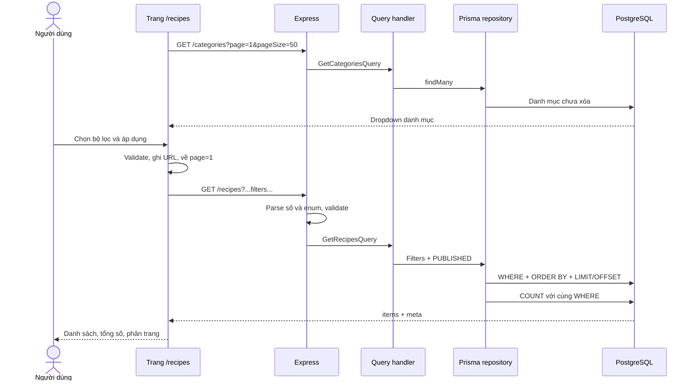

# Bộ lọc công thức end-to-end — issue #35

## Sử dụng

Mở http://localhost:5173/recipes, hoặc chọn **Khám phá công thức** trên trang chủ.
Người đã đăng nhập có thể chọn **Công thức** trong dashboard. Không cần đăng nhập
để lọc danh sách công khai.

Chọn danh mục/độ khó, nhập thời gian nấu tối đa và số khẩu phần tối thiểu,
rồi bấm **Áp dụng bộ lọc**. Ô trống nghĩa là bỏ điều kiện. Kết quả phải thỏa
đồng thời mọi điều kiện đã chọn. **Xóa bộ lọc** khôi phục trang 1, 12 món/trang.

## Luồng dữ liệu



## 1. Danh mục

Frontend gọi GET /api/v1/categories, mỗi trang 50 danh mục và tiếp tục khi
meta.hasNextPage=true. Dropdown vì vậy lấy đầy đủ danh mục, không chỉ trang đầu.
Nhãn là tên, giá trị gửi là UUID.

Backend kiểm tra UUID và thêm where.categoryId = categoryId. Không chọn thì
không thêm điều kiện. Đã bổ sung GetCategoriesQueryHandler và đăng ký trong
container vì API danh mục trước đây chưa có handler.

CategoryRepository loại danh mục xóa mềm. recipeCount chỉ đếm công thức đã
xuất bản và chưa xóa. Kiểu dữ liệu kết quả findMany được sửa thành CategoryDto
để khớp dữ liệu JSON thực tế.

Dropdown dùng state điều khiển giá trị, tránh mất lựa chọn khi danh mục tải
bất đồng bộ sau reload. Nút áp dụng tạm vô hiệu hóa khi danh mục đang tải.

## 2. Độ khó

Dropdown hiển thị Dễ/Trung bình/Khó/Chuyên gia, gửi EASY/MEDIUM/HARD/EXPERT.
API vẫn chấp nhận Easy/Medium/Hard/Expert: chuyển sang chữ hoa rồi kiểm tra enum.

Repository dùng phép bằng. Giá trị lạ trả 422 trước khi truy vấn database.
Các nhãn tiếng Việt chỉ ở frontend; dữ liệu database giữ enum hiện có.

## 3. Thời gian nấu tối đa

maxCookTime phải là số nguyên từ 0 đến 2147483647. Giá trị 0 được giữ nguyên,
không bị loại vì là falsy. Ô trống không gửi tham số.

API nhận chuỗi "30", chuyển thành số 30 và tạo cookTime: { lte: 30 }.
Món 30 phút được lấy; món 31 phút bị loại. Chỉ tính thời gian nấu cookTime,
không cộng thời gian chuẩn bị prepTime.

## 4. Khẩu phần tối thiểu

minServings phải là số nguyên từ 1 đến 2147483647. Repository tạo
servings: { gte: value }. Nhập 2 lấy món có từ 2 khẩu phần trở lên, loại món
chỉ có 1 khẩu phần. Ô trống không thêm điều kiện; 0 hoặc số thập phân bị báo lỗi.

## 5. AND và danh sách công khai

Các điều kiện nằm trong cùng object where nên Prisma kết hợp bằng AND.
Handler luôn buộc status=PUBLISHED, kể cả client gửi status=DRAFT.
Repository luôn thêm isDeleted=false.

Ví dụ chọn danh mục A + EASY + tối đa 30 phút + ít nhất 2 khẩu phần:

```sql
WHERE is_deleted = false
  AND status = 'PUBLISHED'
  AND category_id = :categoryId
  AND difficulty = 'EASY'
  AND cook_time <= 30
  AND servings >= 2
```

Đã bổ sung GetRecipesQueryHandler và đăng ký vào command bus từ bước backend,
nên request hợp lệ không còn gặp lỗi "No handler registered".

## 6. Phân trang và tổng số

Mặc định page=1/pageSize=12. Giao diện chọn 12/24/48; API chấp nhận pageSize
1–50. URL có pageSize hợp lệ khác các lựa chọn chuẩn vẫn được khôi phục.

Prisma dùng skip=(page-1)*pageSize, take=pageSize. findMany và count dùng
cùng where, nên meta.totalCount là tổng số món phù hợp trên mọi trang.
totalPages=ceil(totalCount/pageSize).

Trang trước/sau dựa vào meta.hasPreviousPage/hasNextPage. Chuyển trang giữ
nguyên bộ lọc; áp dụng lại luôn về trang 1.

Mặc định sắp xếp createdAt DESC và id ASC làm điều kiện phụ để thứ tự ổn định
khi nhiều món có cùng thời điểm tạo. Thêm/xóa dữ liệu giữa hai request vẫn có
thể làm phân trang offset dịch chuyển; điều kiện phụ xử lý trường hợp trùng
giá trị sắp xếp.

## 7. URL, reload và Back/Forward

URL là nguồn lưu bộ lọc đã áp dụng:

    /recipes?difficulty=EASY&maxCookTime=30&minServings=2&page=1&pageSize=12

Có thể copy liên kết hoặc reload. React Router đọc URL và khôi phục form/API.
Back/Forward cũng cập nhật bộ lọc theo lịch sử trình duyệt. Thay đổi ô nhập
chưa gửi request cho đến khi bấm áp dụng.

Component được tạo lại khi query string đổi. Cleanup dùng AbortController
hủy request trước và callback kiểm tra signal để phản hồi cũ không ghi đè
kết quả mới.

## 8. Validation và trạng thái UI

Frontend kiểm tra trước khi đổi URL. Backend kiểm tra lại vì API có thể được
gọi trực tiếp. Validator dùng chung xử lý chuỗi số; từ chối chuỗi trống,
tham số số bị lặp hoặc dạng object, số âm/thập phân, độ khó sai và UUID sai.

Giới hạn 2147483647 phù hợp kiểu Int PostgreSQL để tránh lỗi overflow.
Frontend bỏ tham số khi ô trống; gọi API trực tiếp với tham số số trống trả 422.
Lỗi API có errors theo từng trường và không truy vấn database nếu validation sai.

| Trạng thái | Cách xử lý |
|---|---|
| Đang tải | Hiện thông báo tải, aria-busy |
| Không có kết quả | Gợi ý giảm điều kiện hoặc xóa lọc |
| Trang vượt kết quả | Gợi ý về trang trước/áp dụng lại |
| API công thức lỗi | Thông báo và nút Thử lại |
| Danh mục lỗi | Vẫn cho lọc trường khác, có nút Tải lại danh mục |
| URL sai | Không gọi API công thức, cho sửa hoặc xóa |
| Mobile | Form một cột, thẻ món và nút tự xuống dòng |

## Các file chính

| File | Vai trò |
|---|---|
| frontend/src/pages/RecipesPage.tsx | Form, URL, tải dữ liệu, cards, phân trang, retry |
| frontend/src/lib/recipeFilters.ts | Parse/validate frontend, nhãn độ khó |
| frontend/src/lib/recipes.ts | Encode query, gọi API, tải mọi trang danh mục |
| frontend/src/types/recipes.ts | Kiểu dữ liệu kết quả và bộ lọc |
| backend/src/application/validators/queryParameterValidators.ts | Chuẩn hóa số URL |
| backend/src/application/validators/recipeValidators.ts | Validate bốn bộ lọc |
| backend/src/application/handlers/RecipeQueryHandlers.ts | Danh sách PUBLISHED |
| backend/src/application/handlers/CategoryQueryHandlers.ts | API danh mục |
| backend/src/presentation/di/container.ts | Đăng ký handlers |
| backend/src/infrastructure/persistence/repositories/RecipeRepository.ts | WHERE, COUNT, phân trang |
| frontend/playwright.config.ts | Server kiểm thử riêng |
| frontend/e2e/recipe-filtering.spec.ts | Browser → API → PostgreSQL |

## Khởi chạy và kiểm thử

Frontend thực tế dùng React/Vite, không phải Next.js. Chạy backend và frontend
ở hai terminal bằng pnpm dev trong thư mục tương ứng. Frontend ở cổng 5173.
DATABASE_URL và PORT nằm trong backend/.env; không thay đổi dữ liệu đang có.
Nếu hạ tầng chưa chạy, dùng docker compose up -d từ gốc dự án.

frontend/.env.local ưu tiên hơn .env. VITE_API_BASE_URL phải trỏ đúng cổng
backend, ví dụ http://localhost:3000/api/v1. Backend CORS_ORIGINS phải cho phép
http://localhost:5173. Khởi động lại server sau khi sửa biến môi trường.

Frontend:

```powershell
cd frontend
pnpm test
pnpm build
```

Backend:

```powershell
cd backend
pnpm exec vitest run
pnpm exec tsc --noEmit
```

E2E trên Windows dùng Edge đã cài:

```powershell
cd frontend
$env:E2E_BROWSER_CHANNEL = 'msedge'
pnpm test:e2e
```

Hoặc cài Chromium:

```powershell
cd frontend
pnpm exec playwright install chromium
pnpm test:e2e
```

Playwright tự chạy API ở 5051, frontend ở 5175 và dừng sau kiểm thử.
Cần hai cổng này trống. Cấu hình theo [webServer chính thức](https://playwright.dev/docs/test-webserver).

E2E dùng DATABASE_URL trong backend/.env, chỉ đọc dữ liệu, không seed/xóa dữ liệu.
Database cần có schema và ít nhất một món PUBLISHED với danh mục tương ứng.
Khi có hơn 12 món, bài kiểm thử kiểm tra thêm trang 2 và ID không trùng trang 1.

Luồng chính không mock API hay database. Riêng lỗi mạng trong bài retry được
giả lập có chủ đích. Có kiểm tra bốn bộ lọc AND, tổng số, reload/dropdown,
xóa lọc, phân trang/Back, kết quả rỗng, validation, retry và viewport mobile.

Phạm vi là duyệt/lọc danh sách công khai. Trang chi tiết, tạo/sửa công thức và
tìm kiếm toàn văn thuộc các issue khác.


Trong dashboard, bấm Công thức để mở /dashboard/recipes. Bộ lọc và danh sách hiển thị trong vùng nội dung bên phải, giữ menu dashboard và đánh dấu mục đang chọn. Trang công khai /recipes vẫn hoạt động độc lập.
