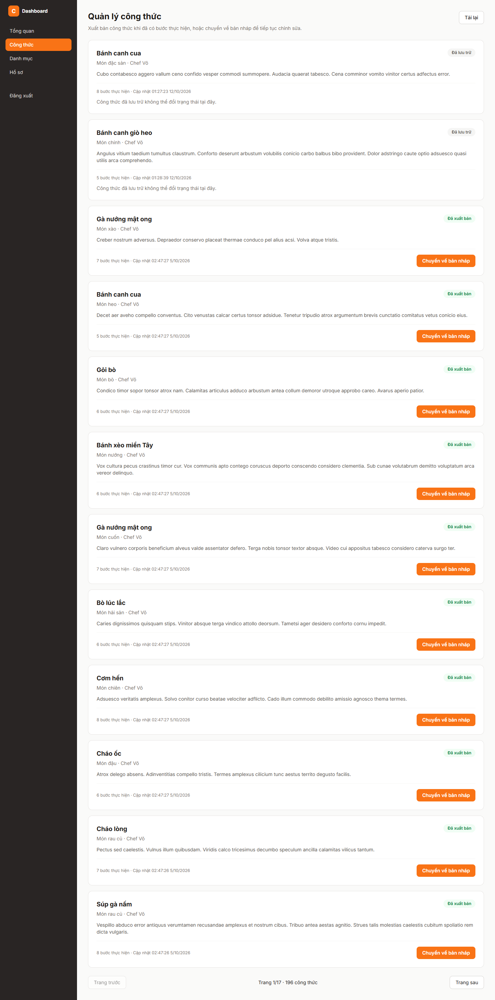

# Báo cáo FR-RCP-005 — Xuất bản và hủy xuất bản công thức

| Thông tin | Nội dung |
|---|---|
| Người thực hiện | Nguyễn Huỳnh Thanh — HUỲNH THÀNH, MSSV 2312748 theo tài liệu PR có sẵn |
| Dự án | Culinary Blog / LetHimCook |
| Ngày lập báo cáo | 14/10/2026 |
| Phân công | Issue #22 trong tài liệu person-3; GitHub [#3](https://github.com/gsb-b60/culinaryblog/issues/3) |
| Kết quả | **Hoàn thành triển khai trên nhánh feat; chưa xác nhận tích hợp master** |
| Repo mã nguồn | [gsb-b60/culinaryblog](https://github.com/gsb-b60/culinaryblog) |
| Phiên bản đối chiếu/demo | [aa0ecc6](https://github.com/gsb-b60/culinaryblog/tree/aa0ecc6); commit thay đổi chính [c5a7efd](https://github.com/gsb-b60/culinaryblog/commit/c5a7efd) |
| Nhánh đã có ở local | `feat-Issue#22-FR-RCP-005-Publish/Unpulish-Recipe` |

## 1. Phân công công việc

Bảng dưới mô tả phần việc do **Huỳnh Thanh** thực hiện/đối chiếu, dựa trên lịch sử Git và phân công Person 3. Không gán thêm người review/kiểm thử khi chưa có minh chứng.

| Hạng mục | Người phụ trách | Công việc |
|---|---|---|
| Backend | Huỳnh Thanh | Xây dựng Publish/Unpublish command, handler; kiểm tra owner/Admin, trạng thái và bước nấu. |
| Frontend | Huỳnh Thanh | Danh sách quản lý, badge trạng thái, nút xuất bản/hủy xuất bản, khóa thao tác khi đang gửi. |
| Kiểm thử và tài liệu | Huỳnh Thanh | Test route, nghiệp vụ, giao diện; viết docs/publish-unpublish-recipe.md. |

Nền tảng xác thực, schema/kiến trúc chung được kế thừa từ nhóm; bảng tổng quan nhóm chỉ dùng làm ngữ cảnh trong [README báo cáo](./README.md).

## 2. Kết quả hoàn thành

- PATCH /recipes/{id}/publish và /unpublish trả 200 cùng RecipeDto; JWT xác định người thao tác.
- Chỉ owner/Admin được đổi trạng thái; 401/403/404 khi không đủ điều kiện.
- Publish yêu cầu ít nhất một bước chưa xóa; thiếu bước hoặc công thức ARCHIVED trả 422.
- DRAFT ↔ PUBLISHED; cập nhật publishedAt, updatedAt, version; yêu cầu lặp lại không tăng version.
- Có kiểm tra version khi cập nhật và phản hồi 409 khi xung đột; vô hiệu hóa cache sau xử lý.
- Giao diện đọc dữ liệu qua GET /recipes/manage và cập nhật theo DTO thật.

## 3. Chưa hoàn thành hoặc chưa đủ minh chứng

- Chưa có bằng chứng kiểm thử cạnh tranh đồng thời/SQL trên PostgreSQL thật cho riêng feat này.
- Chưa xác nhận feat đã được merge vào master; danh sách issue trong README còn trạng thái Open.
- Việc xóa bước cuối của công thức đã xuất bản cần quy tắc phối hợp với feat quản lý bước.

Trạng thái “hoàn thành triển khai” không đồng nghĩa đã merge hoặc đã xác minh mọi điều kiện trên hạ tầng thật. Kết quả này dựa vào snapshot nêu trên, không tự thay đổi trạng thái GitHub issue.

## 4. Liên kết mã nguồn và kiểm thử

- [Mã nguồn của phiên bản feat](https://github.com/gsb-b60/culinaryblog/tree/aa0ecc6)
- [File triển khai chính](https://github.com/gsb-b60/culinaryblog/blob/aa0ecc6/backend/src/application/handlers/RecipeStatusCommandHandlers.ts)
- [Tài liệu/đặc tả được đối chiếu](https://github.com/gsb-b60/culinaryblog/blob/aa0ecc6/docs/publish-unpublish-recipe.md)
- [Issue chức năng](https://github.com/gsb-b60/culinaryblog/issues/3)

Tài liệu gốc mô tả backend tests dùng Prisma/cache mock và stub Passport; frontend dùng HTTP giả lập. Không có số tổng kiểm thử đủ tin cậy để gán riêng feat này.

Lệnh test backend tại đúng snapshot:

```powershell
cd backend
pnpm exec vitest run tests/recipe-status.test.ts
```

Để chạy test frontend: tại thư mục frontend dùng `pnpm test`. Để build: `pnpm build` trong từng thư mục. Số test trong tài liệu là toàn suite tại thời điểm triển khai, không phải tất cả đều do riêng feat này bổ sung.

## 5. Hình demo sản phẩm



Ảnh chụp giao diện/API thật từ snapshot nêu trên, sử dụng dữ liệu PostgreSQL hiện có. [Metadata chụp và HTTP](./evidence/capture-results.json) là nguồn xác nhận ảnh đã tạo thành công. Ảnh màn hình đọc hoặc hộp xác nhận chỉ minh họa UI; không thay bằng chứng chạy toàn bộ luồng cập nhật dữ liệu. Với sắp xếp, ảnh minh họa API field/order hiện có, không phải dropdown đã hoàn thiện.

## 6. Cài đặt/chạy riêng feat

Thực hiện [hướng dẫn cài đặt chung](./CAI-DAT-VA-CHAY.md), chọn đúng phiên bản:

```powershell
git clone https://github.com/gsb-b60/culinaryblog.git culinaryblog-fr-rcp-005
cd culinaryblog-fr-rcp-005
git fetch origin
git checkout aa0ecc6
```

Detached HEAD ở đây chỉ phục vụ tái hiện demo. Nếu commit chưa có trên remote đã fetch, lấy đúng nhánh từ người phụ trách; không thay bằng master rồi báo kết quả cho feat này.

Sau khi cấu hình và khởi động backend/frontend theo hướng dẫn chung, mở `http://localhost:5173/dashboard/recipes`. Backend phải trùng `VITE_API_BASE_URL`; mặc định hướng dẫn là `http://localhost:3000/api/v1`.

Feat không yêu cầu thêm hạ tầng ngoài phần cấu hình chung; dùng schema/dependency đúng snapshot và dữ liệu demo phù hợp.

## 7. Kịch bản trình bày

1. Đăng nhập Author có công thức hoặc Admin; mở trang quản lý.
2. Chọn một công thức Draft có bước nấu để trình bày điều kiện xuất bản.
3. Bấm Xuất bản: kỳ vọng 200, badge Đã xuất bản; reload để kiểm tra lưu DB.
4. Bấm Chuyển về bản nháp: kỳ vọng 200 và badge Bản nháp.
5. Trình bày 422 khi không có bước và 403 cho tài khoản khác chủ sở hữu.

Khi trình bày kết quả, nêu rõ những giới hạn ở mục 3. Các thao tác thay đổi dữ liệu trong kịch bản cần dùng dữ liệu thử; script chụp báo cáo chỉ đọc UI/mở xác nhận.
