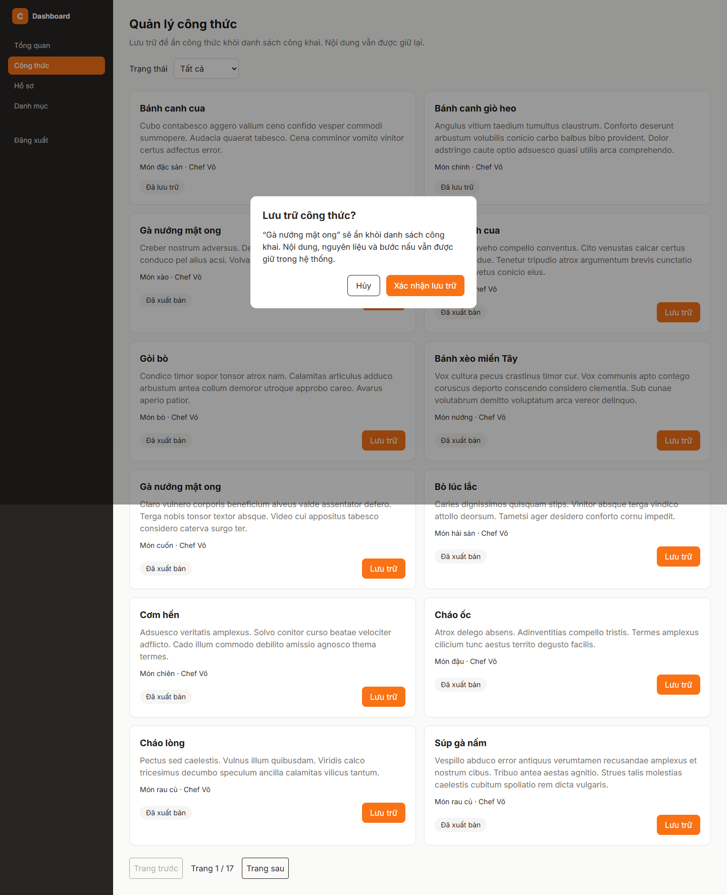

# Báo cáo FR-RCP-006 — Lưu trữ công thức

| Thông tin | Nội dung |
|---|---|
| Người thực hiện | Nguyễn Huỳnh Thanh — HUỲNH THÀNH, MSSV 2312748 theo tài liệu PR có sẵn |
| Dự án | Culinary Blog / LetHimCook |
| Ngày lập báo cáo | 14/10/2026 |
| Phân công | Issue #23 trong tài liệu person-3; GitHub [#32](https://github.com/gsb-b60/culinaryblog/issues/32) |
| Kết quả | **Hoàn thành triển khai trên nhánh feat; có ghi nhận tích hợp PostgreSQL/Redis** |
| Repo mã nguồn | [gsb-b60/culinaryblog](https://github.com/gsb-b60/culinaryblog) |
| Phiên bản đối chiếu/demo | [1fa926b](https://github.com/gsb-b60/culinaryblog/tree/1fa926b); commit thay đổi chính [cc434b0](https://github.com/gsb-b60/culinaryblog/commit/cc434b0) |
| Nhánh đã có ở local | `feat-Issue#23-FR-RCP-006-Archive-Recipe` |

## 1. Phân công công việc

Bảng dưới mô tả phần việc do **Huỳnh Thanh** thực hiện/đối chiếu, dựa trên lịch sử Git và phân công Person 3. Không gán thêm người review/kiểm thử khi chưa có minh chứng.

| Hạng mục | Người phụ trách | Công việc |
|---|---|---|
| Backend | Huỳnh Thanh | Archive handler, owner/Admin, API quản lý/chi tiết và lọc Published cho danh sách công khai. |
| Frontend | Huỳnh Thanh | Trang quản lý, lọc trạng thái, hộp xác nhận lưu trữ, thông báo và tải lại dữ liệu. |
| Kiểm thử và tài liệu | Huỳnh Thanh | Test endpoint, tích hợp PostgreSQL/Redis; tài liệu docs/archive-recipe.md. |

Nền tảng xác thực, schema/kiến trúc chung được kế thừa từ nhóm; bảng tổng quan nhóm chỉ dùng làm ngữ cảnh trong [README báo cáo](./README.md).

## 2. Kết quả hoàn thành

- PATCH /recipes/{id}/archive chuyển Draft/Published sang ARCHIVED và trả 200.
- Giữ công thức cùng nguyên liệu, bước nấu, ảnh; isDeleted vẫn false.
- Danh sách/tìm kiếm công khai buộc PUBLISHED; danh mục dùng truy vấn chỉ Published.
- Owner/Admin vẫn xem công thức đã lưu trữ qua API quản lý và chi tiết có quyền.
- Lưu trữ lặp lại không tăng version; xóa cache chi tiết/danh sách/danh mục/sitemap.
- Giao diện có xác nhận, chặn gửi lặp, báo lỗi và lọc trạng thái.

## 3. Chưa hoàn thành hoặc chưa đủ minh chứng

- Chưa có bằng chứng merge vào master.
- Cache dùng cơ chế best effort; chưa có transaction chung giữa PostgreSQL và Redis.
- Tài liệu gốc chưa có bài kiểm thử điều khiển trình duyệt thật; ảnh báo cáo bổ sung chỉ chứng minh giao diện tại thời điểm chụp.

Trạng thái “hoàn thành triển khai” không đồng nghĩa đã merge hoặc đã xác minh mọi điều kiện trên hạ tầng thật. Kết quả này dựa vào snapshot nêu trên, không tự thay đổi trạng thái GitHub issue.

## 4. Liên kết mã nguồn và kiểm thử

- [Mã nguồn của phiên bản feat](https://github.com/gsb-b60/culinaryblog/tree/1fa926b)
- [File triển khai chính](https://github.com/gsb-b60/culinaryblog/blob/1fa926b/backend/src/application/handlers/ArchiveRecipeCommandHandler.ts)
- [Tài liệu/đặc tả được đối chiếu](https://github.com/gsb-b60/culinaryblog/blob/1fa926b/docs/archive-recipe.md)
- [Issue chức năng](https://github.com/gsb-b60/culinaryblog/issues/32)

Theo docs/archive-recipe.md tại cc434b0: 130 test backend, 98 test frontend và 1 test tích hợp PostgreSQL/JWT/Redis đã đạt; build hai phía đạt. Đây là kết quả ghi nhận trước đây, không phải kết quả chạy lại khi soạn báo cáo.

Lệnh test backend tại đúng snapshot:

```powershell
cd backend
pnpm exec vitest run tests/archiveRecipeEndpoint.test.ts
# Tích hợp có tạo/dọn fixture và vô hiệu hóa cache trên môi trường test:
$env:RUN_RECIPE_ARCHIVE_E2E = '1'
pnpm exec vitest run tests/archiveRecipe.e2e.test.ts
Remove-Item Env:RUN_RECIPE_ARCHIVE_E2E
```

Để chạy test frontend: tại thư mục frontend dùng `pnpm test`. Để build: `pnpm build` trong từng thư mục. Số test trong tài liệu là toàn suite tại thời điểm triển khai, không phải tất cả đều do riêng feat này bổ sung.

## 5. Hình demo sản phẩm



Ảnh chụp giao diện/API thật từ snapshot nêu trên, sử dụng dữ liệu PostgreSQL hiện có. [Metadata chụp và HTTP](./evidence/capture-results.json) là nguồn xác nhận ảnh đã tạo thành công. Ảnh màn hình đọc hoặc hộp xác nhận chỉ minh họa UI; không thay bằng chứng chạy toàn bộ luồng cập nhật dữ liệu. Với sắp xếp, ảnh minh họa API field/order hiện có, không phải dropdown đã hoàn thiện.

## 6. Cài đặt/chạy riêng feat

Thực hiện [hướng dẫn cài đặt chung](./CAI-DAT-VA-CHAY.md), chọn đúng phiên bản:

```powershell
git clone https://github.com/gsb-b60/culinaryblog.git culinaryblog-fr-rcp-006
cd culinaryblog-fr-rcp-006
git fetch origin
git checkout 1fa926b
```

Detached HEAD ở đây chỉ phục vụ tái hiện demo. Nếu commit chưa có trên remote đã fetch, lấy đúng nhánh từ người phụ trách; không thay bằng master rồi báo kết quả cho feat này.

Sau khi cấu hình và khởi động backend/frontend theo hướng dẫn chung, mở `http://localhost:5173/dashboard/recipes`. Backend phải trùng `VITE_API_BASE_URL`; mặc định hướng dẫn là `http://localhost:3000/api/v1`.

Feat không yêu cầu thêm hạ tầng ngoài phần cấu hình chung; dùng schema/dependency đúng snapshot và dữ liệu demo phù hợp.

## 7. Kịch bản trình bày

1. Đăng nhập và mở trang quản lý; chọn công thức chưa Archived.
2. Bấm Lưu trữ để mở hộp xác nhận; giải thích dữ liệu được giữ lại.
3. Xác nhận trong môi trường thử nghiệm: PATCH trả 200, trạng thái ARCHIVED.
4. Kiểm tra danh sách công khai không còn công thức; bộ lọc quản lý Đã lưu trữ vẫn thấy.
5. Kiểm tra DB: status=ARCHIVED, is_deleted=false và quan hệ con còn nguyên.

Khi trình bày kết quả, nêu rõ những giới hạn ở mục 3. Các thao tác thay đổi dữ liệu trong kịch bản cần dùng dữ liệu thử; script chụp báo cáo chỉ đọc UI/mở xác nhận.
