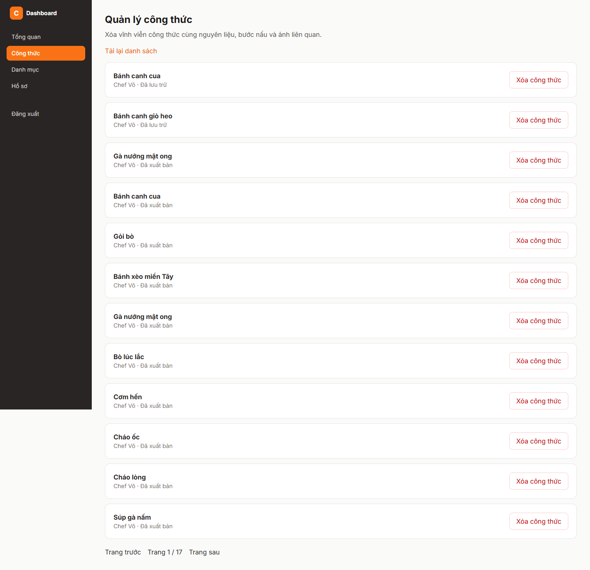

# Báo cáo FR-RCP-007 — Xóa công thức và dọn file ảnh

| Thông tin | Nội dung |
|---|---|
| Người thực hiện | Nguyễn Huỳnh Thanh — HUỲNH THÀNH, MSSV 2312748 theo tài liệu PR có sẵn |
| Dự án | Culinary Blog / LetHimCook |
| Ngày lập báo cáo | 14/10/2026 |
| Phân công | Issue #24 trong tài liệu person-3; GitHub [#33](https://github.com/gsb-b60/culinaryblog/issues/33) |
| Kết quả | **Hoàn thành phần ứng dụng; chưa xác minh xóa object MinIO thật** |
| Repo mã nguồn | [gsb-b60/culinaryblog](https://github.com/gsb-b60/culinaryblog) |
| Phiên bản đối chiếu/demo | [3b3285e](https://github.com/gsb-b60/culinaryblog/tree/3b3285e); commit thay đổi chính [a6cfe48](https://github.com/gsb-b60/culinaryblog/commit/a6cfe48) |
| Nhánh đã có ở local | `feat-Issue#24-FR-RCP-007-Delete-Recipe` |

## 1. Phân công công việc

Bảng dưới mô tả phần việc do **Huỳnh Thanh** thực hiện/đối chiếu, dựa trên lịch sử Git và phân công Person 3. Không gán thêm người review/kiểm thử khi chưa có minh chứng.

| Hạng mục | Người phụ trách | Công việc |
|---|---|---|
| Backend và database | Huỳnh Thanh | Hard delete trong transaction; cascade quan hệ; bảng FileCleanupTask giữ yêu cầu dọn ảnh. |
| Queue và storage | Huỳnh Thanh | Relay outbox sang BullMQ, worker MinIO, lọc object key và retry. |
| Frontend, kiểm thử, tài liệu | Huỳnh Thanh | Hộp xác nhận xóa, API 204, cập nhật danh sách; unit/integration tests và DELETE_RECIPE_GUIDE.md. |

Nền tảng xác thực, schema/kiến trúc chung được kế thừa từ nhóm; bảng tổng quan nhóm chỉ dùng làm ngữ cảnh trong [README báo cáo](./README.md).

## 2. Kết quả hoàn thành

- DELETE /recipes/{id} yêu cầu JWT và owner/Admin, thành công trả 204 không body.
- Xóa vĩnh viễn công thức; cascade bước, nguyên liệu và record ảnh; không xóa User/Category.
- Lưu FileCleanupTask trong cùng transaction để không mất yêu cầu dọn file khi Redis lỗi.
- Relay đưa task sang queue file-cleanup; worker xử lý ảnh gốc/biến thể/ảnh bước trong phạm vi recipe.
- BullMQ attempts=4 tương ứng lần đầu và tối đa ba lần thử lại; giữ failed job để kiểm tra.
- Giao diện xác nhận/hủy, khóa khi xóa, báo lỗi; cập nhật danh sách và lùi trang khi cần.

## 3. Chưa hoàn thành hoặc chưa đủ minh chứng

- Chưa xác minh upload/xóa object trên MinIO thật; tài liệu cũ ghi dịch vụ không chạy và lỗi tải image.
- Chưa xác nhận merge master.
- Cần phối hợp worker resize tương lai để không ghi lại ảnh sau khi công thức đã xóa.

Trạng thái “hoàn thành triển khai” không đồng nghĩa đã merge hoặc đã xác minh mọi điều kiện trên hạ tầng thật. Kết quả này dựa vào snapshot nêu trên, không tự thay đổi trạng thái GitHub issue.

## 4. Liên kết mã nguồn và kiểm thử

- [Mã nguồn của phiên bản feat](https://github.com/gsb-b60/culinaryblog/tree/3b3285e)
- [File triển khai chính](https://github.com/gsb-b60/culinaryblog/blob/3b3285e/backend/src/application/handlers/DeleteRecipeCommandHandler.ts)
- [Tài liệu/đặc tả được đối chiếu](https://github.com/gsb-b60/culinaryblog/blob/3b3285e/backend/DELETE_RECIPE_GUIDE.md)
- [Issue chức năng](https://github.com/gsb-b60/culinaryblog/issues/33)

Theo backend/DELETE_RECIPE_GUIDE.md tại a6cfe48: 143 unit/endpoint tests backend, 100 tests frontend, build/lint đạt. Tích hợp PostgreSQL/Redis/JWT/cascade/outbox/retry đã đạt nhưng thao tác MinIO được mock. Không chạy lại những phép xóa khi soạn báo cáo.

Lệnh test backend tại đúng snapshot:

```powershell
cd backend
pnpm exec vitest run tests/delete-recipe.test.ts tests/delete-recipe-endpoint.test.ts tests/file-cleanup.test.ts
# Chỉ chạy tích hợp trên môi trường test đã chuẩn bị:
$env:RUN_RECIPE_INFRA_TESTS = '1'
pnpm exec vitest run tests/delete-recipe-infrastructure.test.ts
Remove-Item Env:RUN_RECIPE_INFRA_TESTS
```

Để chạy test frontend: tại thư mục frontend dùng `pnpm test`. Để build: `pnpm build` trong từng thư mục. Số test trong tài liệu là toàn suite tại thời điểm triển khai, không phải tất cả đều do riêng feat này bổ sung.

## 5. Hình demo sản phẩm



Ảnh chụp giao diện/API thật từ snapshot nêu trên, sử dụng dữ liệu PostgreSQL hiện có. [Metadata chụp và HTTP](./evidence/capture-results.json) là nguồn xác nhận ảnh đã tạo thành công. Ảnh màn hình đọc hoặc hộp xác nhận chỉ minh họa UI; không thay bằng chứng chạy toàn bộ luồng cập nhật dữ liệu. Với sắp xếp, ảnh minh họa API field/order hiện có, không phải dropdown đã hoàn thiện.

## 6. Cài đặt/chạy riêng feat

Thực hiện [hướng dẫn cài đặt chung](./CAI-DAT-VA-CHAY.md), chọn đúng phiên bản:

```powershell
git clone https://github.com/gsb-b60/culinaryblog.git culinaryblog-fr-rcp-007
cd culinaryblog-fr-rcp-007
git fetch origin
git checkout 3b3285e
```

Detached HEAD ở đây chỉ phục vụ tái hiện demo. Nếu commit chưa có trên remote đã fetch, lấy đúng nhánh từ người phụ trách; không thay bằng master rồi báo kết quả cho feat này.

Sau khi cấu hình và khởi động backend/frontend theo hướng dẫn chung, mở `http://localhost:5173/dashboard/recipes`. Backend phải trùng `VITE_API_BASE_URL`; mặc định hướng dẫn là `http://localhost:3000/api/v1`.

Feat này thêm migration `20261006130000_add_file_cleanup_outbox`. Database mới dùng `pnpm exec prisma migrate deploy` sau khi sinh client. Database local từng tạo bằng `db push` cần kiểm tra diff/baseline trước; không dùng reset hoặc accept-data-loss để bổ sung bảng.

## 7. Kịch bản trình bày

1. Dùng công thức thử nghiệm, mở trang quản lý và chọn Xóa.
2. Trình bày hộp xác nhận và khả năng Hủy trước khi gửi yêu cầu.
3. Nếu chạy thử nghiệm riêng: xác nhận xóa, kiểm tra DELETE 204 và danh sách không còn công thức.
4. Kiểm tra cascade DB, outbox và queue; giải thích 204 chưa đồng nghĩa file MinIO đã xóa ngay.
5. Kiểm chứng MinIO thật chỉ khi endpoint/bucket/credentials sẵn sàng.

Khi trình bày kết quả, nêu rõ những giới hạn ở mục 3. Các thao tác thay đổi dữ liệu trong kịch bản cần dùng dữ liệu thử; script chụp báo cáo chỉ đọc UI/mở xác nhận.
