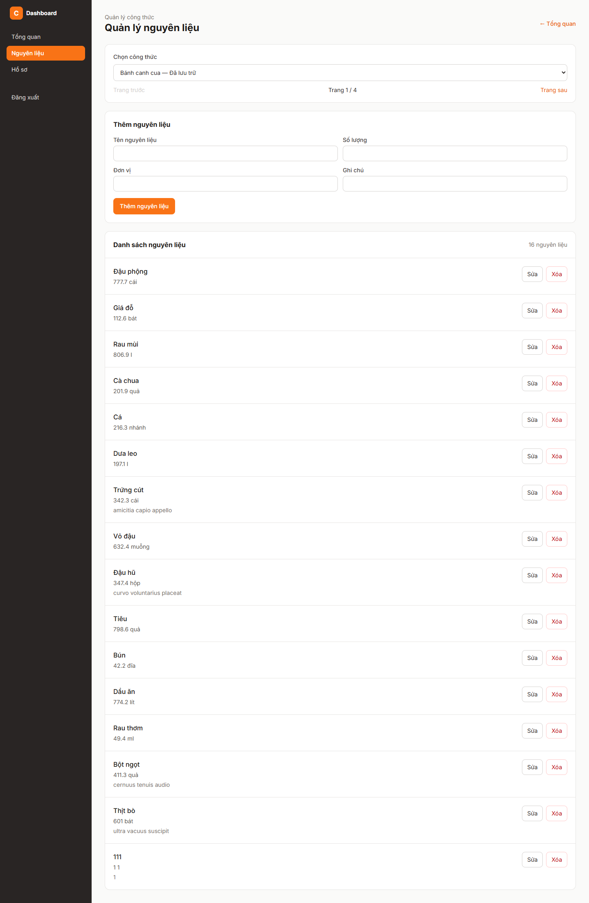

# Báo cáo FR-RCP-009 — Quản lý nguyên liệu

| Thông tin | Nội dung |
|---|---|
| Người thực hiện | Nguyễn Huỳnh Thanh — HUỲNH THÀNH, MSSV 2312748 theo tài liệu PR có sẵn |
| Dự án | Culinary Blog / LetHimCook |
| Ngày lập báo cáo | 14/10/2026 |
| Phân công | Issue #25 trong tài liệu person-3; GitHub [#6](https://github.com/gsb-b60/culinaryblog/issues/6) |
| Kết quả | **Hoàn thành API và giao diện trên nhánh feat; chưa xác minh đầy đủ E2E** |
| Repo mã nguồn | [gsb-b60/culinaryblog](https://github.com/gsb-b60/culinaryblog) |
| Phiên bản đối chiếu/demo | [c43d091](https://github.com/gsb-b60/culinaryblog/tree/c43d091); commit thay đổi chính [c43d091](https://github.com/gsb-b60/culinaryblog/commit/c43d091) |
| Nhánh đã có ở local | `feat-frontend-add/delete/fix-ingredient-management` |

## 1. Phân công công việc

Bảng dưới mô tả phần việc do **Huỳnh Thanh** thực hiện/đối chiếu, dựa trên lịch sử Git và phân công Person 3. Không gán thêm người review/kiểm thử khi chưa có minh chứng.

| Hạng mục | Người phụ trách | Công việc |
|---|---|---|
| Backend | Huỳnh Thanh | CRUD nguyên liệu; kiểm tra chủ sở hữu/Admin và dữ liệu; truy vấn công thức được quản lý. |
| Frontend | Huỳnh Thanh | Chọn công thức; form thêm/sửa/xóa nguyên liệu, xác nhận xóa, phân trang công thức. |
| Kiểm thử | Huỳnh Thanh | recipe-ingredient-commands.test.ts, recipeQueryHandler.test.ts và IngredientManagementPage.test.tsx. |

Nền tảng xác thực, schema/kiến trúc chung được kế thừa từ nhóm; bảng tổng quan nhóm chỉ dùng làm ngữ cảnh trong [README báo cáo](./README.md).

## 2. Kết quả hoàn thành

- POST /recipes/{id}/ingredients trả 201; PUT /recipes/{id}/ingredients/{ingId} trả 200; DELETE trả 204.
- Quản lý tên, số lượng, đơn vị, ghi chú, orderIndex; danh sách hiển thị theo thứ tự.
- Chỉ owner/Admin được sửa; không có công thức/nguyên liệu trả 404; sai dữ liệu trả 422.
- DELETE nguyên liệu dùng xóa mềm isDeleted=true; không nhầm với hard delete cả công thức.
- Trang quản lý có chọn công thức, thêm/sửa/xóa, trạng thái chờ và thông báo tiếng Việt.
- Bổ sung GET /recipes/manageable và GET /recipes/{id}/ingredients phục vụ UI.

## 3. Chưa hoàn thành hoặc chưa đủ minh chứng

- Chưa có báo cáo chạy E2E trình duyệt với database thật trong tài liệu feat đã đọc.
- Bản cập nhật e2d8d30 đã có tài liệu kiểm thử dịch vụ thật; kết quả này thuộc phiên bản mới, không áp ngược cho mọi nhánh feat.
- README đánh dấu FR-RCP-009 Done nhưng bảng person-3 vẫn Open; giao diện bổ sung nằm trên nhánh riêng.

Trạng thái “hoàn thành triển khai” không đồng nghĩa đã merge hoặc đã xác minh mọi điều kiện trên hạ tầng thật. Kết quả này dựa vào snapshot nêu trên, không tự thay đổi trạng thái GitHub issue.

## 4. Liên kết mã nguồn và kiểm thử

- [Mã nguồn của phiên bản feat](https://github.com/gsb-b60/culinaryblog/tree/c43d091)
- [File triển khai chính](https://github.com/gsb-b60/culinaryblog/blob/c43d091/backend/src/application/handlers/RecipeIngredientCommandHandlers.ts)
- [Tài liệu/đặc tả được đối chiếu](https://github.com/gsb-b60/culinaryblog/blob/c43d091/docs/issues/person-3.md)
- [Issue chức năng](https://github.com/gsb-b60/culinaryblog/issues/6)

Bản cập nhật [e2d8d30](https://github.com/gsb-b60/culinaryblog/commit/e2d8d30), tài liệu [TESTING_REAL_SERVICES.md](../../../backend/TESTING_REAL_SERVICES.md), ghi nhận backend **160/160 tests, coverage 84,69%**. Tests mới kiểm tra API CRUD nguyên liệu qua JWT/Express/CommandBus và PostgreSQL thật; có tích hợp Redis, MinIO, MailHog và BullMQ thật. Đây là kết quả tài liệu đã ghi, chưa chạy lại trong lượt báo cáo và chưa phải E2E trình duyệt.

Lệnh test backend tại đúng snapshot:

```powershell
cd backend
pnpm exec vitest run tests/recipe-ingredient-commands.test.ts tests/recipeQueryHandler.test.ts
```

Để chạy test frontend: tại thư mục frontend dùng `pnpm test`. Để build: `pnpm build` trong từng thư mục. Số test trong tài liệu là toàn suite tại thời điểm triển khai, không phải tất cả đều do riêng feat này bổ sung.

## 5. Hình demo sản phẩm



Ảnh chụp giao diện/API thật từ snapshot nêu trên, sử dụng dữ liệu PostgreSQL hiện có. [Metadata chụp và HTTP](./evidence/capture-results.json) là nguồn xác nhận ảnh đã tạo thành công. Ảnh màn hình đọc hoặc hộp xác nhận chỉ minh họa UI; không thay bằng chứng chạy toàn bộ luồng cập nhật dữ liệu. Với sắp xếp, ảnh minh họa API field/order hiện có, không phải dropdown đã hoàn thiện.

## 6. Cài đặt/chạy riêng feat

Thực hiện [hướng dẫn cài đặt chung](./CAI-DAT-VA-CHAY.md), chọn đúng phiên bản:

```powershell
git clone https://github.com/gsb-b60/culinaryblog.git culinaryblog-fr-rcp-009
cd culinaryblog-fr-rcp-009
git fetch origin
git checkout c43d091
```

Detached HEAD ở đây chỉ phục vụ tái hiện demo. Nếu commit chưa có trên remote đã fetch, lấy đúng nhánh từ người phụ trách; không thay bằng master rồi báo kết quả cho feat này.

Sau khi cấu hình và khởi động backend/frontend theo hướng dẫn chung, mở `http://localhost:5173/dashboard/ingredients`. Backend phải trùng `VITE_API_BASE_URL`; mặc định hướng dẫn là `http://localhost:3000/api/v1`.

Feat không yêu cầu thêm hạ tầng ngoài phần cấu hình chung; dùng schema/dependency đúng snapshot và dữ liệu demo phù hợp.

## 7. Kịch bản trình bày

1. Đăng nhập Author/Admin; mở Quản lý nguyên liệu và chọn công thức.
2. Nhập một nguyên liệu thử với tên, lượng, đơn vị và ghi chú; thêm để nhận 201.
3. Sửa số lượng, lưu để nhận 200 và xem dữ liệu mới.
4. Mở xác nhận xóa; Hủy hoặc xóa trên dữ liệu thử để nhận 204.
5. Kiểm tra trường tên rỗng, lượng sai và tài khoản không có quyền.

Khi trình bày kết quả, nêu rõ những giới hạn ở mục 3. Các thao tác thay đổi dữ liệu trong kịch bản cần dùng dữ liệu thử; script chụp báo cáo chỉ đọc UI/mở xác nhận.

## Bản tích hợp trên master mới — 21/10/2026

Hướng dẫn snapshot phía trên được giữ làm lịch sử. Để sử dụng phiên bản đã thích ứng DashboardLayout, Zustand và API /recipes/manage của master `1ed7022`, xem [Tích hợp quản lý nguyên liệu với master mới](./09-tich-hop-nguyen-lieu-master.md). Bản mới nằm trên nhánh local `feat/integrate-ingredients-master`, đã kiểm tra CRUD desktop/mobile với PostgreSQL thật; chưa được merge vào master trên GitHub.