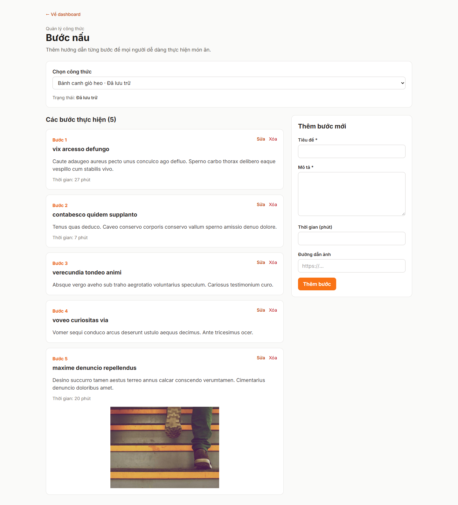

# Báo cáo FR-RCP-010 — Quản lý bước nấu

| Thông tin | Nội dung |
|---|---|
| Người thực hiện | Nguyễn Huỳnh Thanh — HUỲNH THÀNH, MSSV 2312748 theo tài liệu PR có sẵn |
| Dự án | Culinary Blog / LetHimCook |
| Ngày lập báo cáo | 14/10/2026 |
| Phân công | Issue #26 trong tài liệu person-3; GitHub [#34](https://github.com/gsb-b60/culinaryblog/issues/34) |
| Kết quả | **Hoàn thành API và giao diện; chưa xác minh cạnh tranh trên PostgreSQL thật** |
| Repo mã nguồn | [gsb-b60/culinaryblog](https://github.com/gsb-b60/culinaryblog) |
| Phiên bản đối chiếu/demo | [423407a](https://github.com/gsb-b60/culinaryblog/tree/423407a); commit thay đổi chính [423407a](https://github.com/gsb-b60/culinaryblog/commit/423407a) |
| Nhánh đã có ở local | `Issue#26-FR-RCP-010-Step-Management(CRUD)` |

## 1. Phân công công việc

Bảng dưới mô tả phần việc do **Huỳnh Thanh** thực hiện/đối chiếu, dựa trên lịch sử Git và phân công Person 3. Không gán thêm người review/kiểm thử khi chưa có minh chứng.

| Hạng mục | Người phụ trách | Công việc |
|---|---|---|
| Backend | Huỳnh Thanh | CRUD bước, transaction, khóa dòng công thức và đánh lại số sau xóa. |
| Frontend | Huỳnh Thanh | Chọn công thức; danh sách bước, form thêm/sửa, ảnh URL/thời gian và xác nhận xóa. |
| Kiểm thử và tài liệu | Huỳnh Thanh | Test command/query/endpoint/UI; backend/RECIPE_STEPS_GUIDE.md. |

Nền tảng xác thực, schema/kiến trúc chung được kế thừa từ nhóm; bảng tổng quan nhóm chỉ dùng làm ngữ cảnh trong [README báo cáo](./README.md).

## 2. Kết quả hoàn thành

- POST /recipes/{id}/steps trả 201, PUT /recipes/{id}/steps/{stepId} trả 200, DELETE trả 204.
- Bước mới nhận max(stepNumber)+1; công thức chưa có bước bắt đầu từ 1.
- Xóa vật lý một bước rồi đánh lại số liên tiếp trong transaction, giữ ID các bước còn lại.
- Kiểm tra owner/Admin; bước phải thuộc đúng công thức; validation title/description/timerMinutes/imageUrl.
- Có SELECT FOR UPDATE trong transaction nhằm tuần tự hóa thay đổi bước trên cùng công thức.
- Frontend gọi API quản lý /recipes/managed và /recipes/{id}/steps; hiển thị loading/lỗi và giữ form khi lỗi.

## 3. Chưa hoàn thành hoặc chưa đủ minh chứng

- Chưa kiểm chứng khóa dòng, rollback và yêu cầu đồng thời bằng PostgreSQL thật; persistence/JWT trong tests gốc được mô phỏng.
- timerMinutes chỉ lưu dữ liệu, chưa có đồng hồ đếm ngược; imageUrl chỉ lưu URL, chưa upload ảnh trong feat này.
- Chưa xác nhận merge master.

Trạng thái “hoàn thành triển khai” không đồng nghĩa đã merge hoặc đã xác minh mọi điều kiện trên hạ tầng thật. Kết quả này dựa vào snapshot nêu trên, không tự thay đổi trạng thái GitHub issue.

## 4. Liên kết mã nguồn và kiểm thử

- [Mã nguồn của phiên bản feat](https://github.com/gsb-b60/culinaryblog/tree/423407a)
- [File triển khai chính](https://github.com/gsb-b60/culinaryblog/blob/423407a/backend/src/application/handlers/RecipeStepCommandHandlers.ts)
- [Tài liệu/đặc tả được đối chiếu](https://github.com/gsb-b60/culinaryblog/blob/423407a/backend/RECIPE_STEPS_GUIDE.md)
- [Issue chức năng](https://github.com/gsb-b60/culinaryblog/issues/34)

Theo RECIPE_STEPS_GUIDE.md tại 423407a: sau kết nối frontend có 101/101 tests frontend và 183/183 tests backend đạt; sau chỉnh kiểu status đã chạy lại 58 tests liên quan và typecheck đạt. Không cộng các số này vì là những lần chạy khác nhau; chưa chạy lại trong phiên báo cáo.

Lệnh test backend tại đúng snapshot:

```powershell
cd backend
pnpm exec vitest run tests/recipe-step-endpoints.test.ts tests/recipe-step-queries.test.ts tests/recipe-publication-commands.test.ts
```

Để chạy test frontend: tại thư mục frontend dùng `pnpm test`. Để build: `pnpm build` trong từng thư mục. Số test trong tài liệu là toàn suite tại thời điểm triển khai, không phải tất cả đều do riêng feat này bổ sung.

## 5. Hình demo sản phẩm



Ảnh chụp giao diện/API thật từ snapshot nêu trên, sử dụng dữ liệu PostgreSQL hiện có. [Metadata chụp và HTTP](./evidence/capture-results.json) là nguồn xác nhận ảnh đã tạo thành công. Ảnh màn hình đọc hoặc hộp xác nhận chỉ minh họa UI; không thay bằng chứng chạy toàn bộ luồng cập nhật dữ liệu. Với sắp xếp, ảnh minh họa API field/order hiện có, không phải dropdown đã hoàn thiện.

## 6. Cài đặt/chạy riêng feat

Thực hiện [hướng dẫn cài đặt chung](./CAI-DAT-VA-CHAY.md), chọn đúng phiên bản:

```powershell
git clone https://github.com/gsb-b60/culinaryblog.git culinaryblog-fr-rcp-010
cd culinaryblog-fr-rcp-010
git fetch origin
git checkout 423407a
```

Detached HEAD ở đây chỉ phục vụ tái hiện demo. Nếu commit chưa có trên remote đã fetch, lấy đúng nhánh từ người phụ trách; không thay bằng master rồi báo kết quả cho feat này.

Sau khi cấu hình và khởi động backend/frontend theo hướng dẫn chung, mở `http://localhost:5173/dashboard/recipe-steps`. Backend phải trùng `VITE_API_BASE_URL`; mặc định hướng dẫn là `http://localhost:3000/api/v1`.

Feat không yêu cầu thêm hạ tầng ngoài phần cấu hình chung; dùng schema/dependency đúng snapshot và dữ liệu demo phù hợp.

## 7. Kịch bản trình bày

1. Đăng nhập rồi chọn Bước nấu, mở công thức có sẵn.
2. Thêm bước với title/description; kiểm tra số mới do server cấp.
3. Sửa nội dung một bước; số thứ tự giữ nguyên.
4. Xóa bước thứ 2 trong bộ 1–2–3 trên dữ liệu thử; danh sách còn 1–2.
5. Trình bày lỗi nội dung rỗng và timer âm; giải thích transaction/khóa dòng.

Khi trình bày kết quả, nêu rõ những giới hạn ở mục 3. Các thao tác thay đổi dữ liệu trong kịch bản cần dùng dữ liệu thử; script chụp báo cáo chỉ đọc UI/mở xác nhận.
