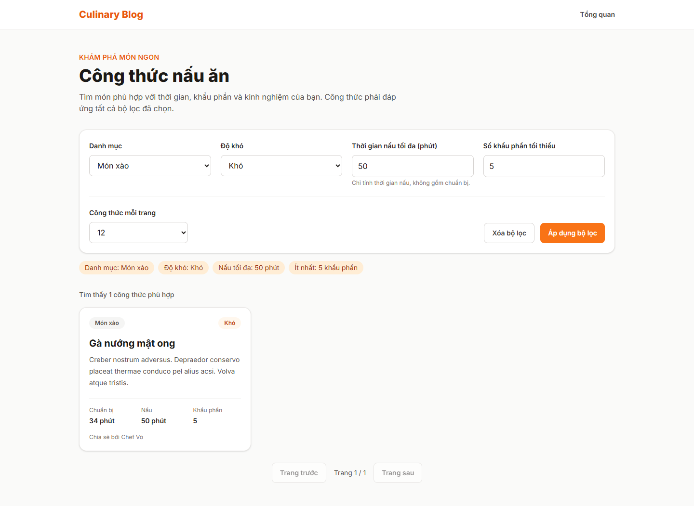

# Báo cáo FR-SRCH-002 — Lọc công thức

| Thông tin | Nội dung |
|---|---|
| Người thực hiện | Nguyễn Huỳnh Thanh — HUỲNH THÀNH, MSSV 2312748 theo tài liệu PR có sẵn |
| Dự án | Culinary Blog / LetHimCook |
| Ngày lập báo cáo | 14/10/2026 |
| Phân công | Issue #27 trong tài liệu person-3; GitHub [#35](https://github.com/gsb-b60/culinaryblog/issues/35) |
| Kết quả | **Hoàn thành triển khai lọc; kết quả kiểm thử cũ cần phân biệt với chạy lại** |
| Repo mã nguồn | [gsb-b60/culinaryblog](https://github.com/gsb-b60/culinaryblog) |
| Phiên bản đối chiếu/demo | [c620451](https://github.com/gsb-b60/culinaryblog/tree/c620451); commit thay đổi chính [c620451](https://github.com/gsb-b60/culinaryblog/commit/c620451) |
| Nhánh đã có ở local | `feat-Issue#27-FR-SRCH-002-Filtering-Recipe` |

## 1. Phân công công việc

Bảng dưới mô tả phần việc do **Huỳnh Thanh** thực hiện/đối chiếu, dựa trên lịch sử Git và phân công Person 3. Không gán thêm người review/kiểm thử khi chưa có minh chứng.

| Hạng mục | Người phụ trách | Công việc |
|---|---|---|
| Backend | Huỳnh Thanh | Chuẩn hóa/validate query; minServings; handler recipes/categories; Prisma WHERE và COUNT cùng điều kiện. |
| Frontend | Huỳnh Thanh | Bốn bộ lọc, URL/reload/Back/Forward, kết quả, phân trang, giao diện công khai/dashboard. |
| Kiểm thử và tài liệu | Huỳnh Thanh | Unit/API/UI tests; Playwright E2E; docs/recipe-filtering-e2e.md. |

Nền tảng xác thực, schema/kiến trúc chung được kế thừa từ nhóm; bảng tổng quan nhóm chỉ dùng làm ngữ cảnh trong [README báo cáo](./README.md).

## 2. Kết quả hoàn thành

- GET /recipes lọc categoryId, difficulty, maxCookTime và minServings với logic AND trước phân trang.
- difficulty chấp nhận Easy/Medium/Hard/Expert rồi chuẩn hóa chữ hoa; dữ liệu không hợp lệ trả 422.
- Danh sách công khai chỉ PUBLISHED và isDeleted=false; totalCount dùng cùng WHERE.
- Bộ lọc lưu trên URL, khôi phục khi reload và Back/Forward; áp dụng lọc đưa về trang 1.
- Giao diện có trạng thái tải/lỗi/không kết quả, xóa lọc, retry và responsive.
- Có đăng ký query handlers danh sách công thức/danh mục và bộ test Playwright.

## 3. Chưa hoàn thành hoặc chưa đủ minh chứng

- Chưa xác nhận merge master.
- Tài liệu PR chưa theo dõi docs/PR-FR-SRCH-002.md ghi backend coverage 42,06% dưới ngưỡng 80%; cần chạy lại để xác nhận số hiện tại.
- Không bao gồm tìm kiếm toàn văn, trang chi tiết hay tạo/sửa công thức.

Trạng thái “hoàn thành triển khai” không đồng nghĩa đã merge hoặc đã xác minh mọi điều kiện trên hạ tầng thật. Kết quả này dựa vào snapshot nêu trên, không tự thay đổi trạng thái GitHub issue.

## 4. Liên kết mã nguồn và kiểm thử

- [Mã nguồn của phiên bản feat](https://github.com/gsb-b60/culinaryblog/tree/c620451)
- [File triển khai chính](https://github.com/gsb-b60/culinaryblog/blob/c620451/frontend/src/pages/RecipesPage.tsx)
- [Tài liệu/đặc tả được đối chiếu](https://github.com/gsb-b60/culinaryblog/blob/c620451/docs/recipe-filtering-e2e.md)
- [Issue chức năng](https://github.com/gsb-b60/culinaryblog/issues/35)

Bản PR có sẵn ghi backend 153/153, frontend 116/116 và Playwright 4/4 đạt; backend pnpm test vẫn thất bại vì ngưỡng coverage. Đây là ghi nhận từ tài liệu chưa được Git theo dõi, không phải log chạy mới. Test Playwright tại c620451 dùng API/PostgreSQL thật cho luồng chính; lỗi mạng được giả lập có chủ đích.

Lệnh test backend tại đúng snapshot:

```powershell
cd backend
pnpm exec vitest run tests/recipe-filtering.test.ts tests/category-listing.test.ts
```

Để chạy test frontend: tại thư mục frontend dùng `pnpm test`. Để build: `pnpm build` trong từng thư mục. Số test trong tài liệu là toàn suite tại thời điểm triển khai, không phải tất cả đều do riêng feat này bổ sung.

## 5. Hình demo sản phẩm



Ảnh chụp giao diện/API thật từ snapshot nêu trên, sử dụng dữ liệu PostgreSQL hiện có. [Metadata chụp và HTTP](./evidence/capture-results.json) là nguồn xác nhận ảnh đã tạo thành công. Ảnh màn hình đọc hoặc hộp xác nhận chỉ minh họa UI; không thay bằng chứng chạy toàn bộ luồng cập nhật dữ liệu. Với sắp xếp, ảnh minh họa API field/order hiện có, không phải dropdown đã hoàn thiện.

## 6. Cài đặt/chạy riêng feat

Thực hiện [hướng dẫn cài đặt chung](./CAI-DAT-VA-CHAY.md), chọn đúng phiên bản:

```powershell
git clone https://github.com/gsb-b60/culinaryblog.git culinaryblog-fr-srch-002
cd culinaryblog-fr-srch-002
git fetch origin
git checkout c620451
```

Detached HEAD ở đây chỉ phục vụ tái hiện demo. Nếu commit chưa có trên remote đã fetch, lấy đúng nhánh từ người phụ trách; không thay bằng master rồi báo kết quả cho feat này.

Sau khi cấu hình và khởi động backend/frontend theo hướng dẫn chung, mở `http://localhost:5173/recipes`. Backend phải trùng `VITE_API_BASE_URL`; mặc định hướng dẫn là `http://localhost:3000/api/v1`.

E2E: ở frontend chạy `$env:E2E_BROWSER_CHANNEL = 'msedge'` rồi `pnpm test:e2e`. Cấu hình khởi chạy API 5051 và frontend 5175, cần database có công thức Published. Lệnh test:e2e chỉ có tại nhánh/commit của feat lọc.

## 7. Kịch bản trình bày

1. Mở /recipes hoặc Công thức trong dashboard.
2. Chọn một danh mục và độ khó phù hợp dữ liệu; nhập thời gian tối đa và khẩu phần tối thiểu.
3. Áp dụng; kiểm tra URL, danh sách và tổng kết quả thỏa đồng thời bốn điều kiện.
4. Reload/Back để chứng minh bộ lọc khôi phục; xóa bộ lọc để quay về mặc định.
5. Nhập số khẩu phần rất lớn để xem trạng thái rỗng và kiểm tra lỗi đầu vào.

Khi trình bày kết quả, nêu rõ những giới hạn ở mục 3. Các thao tác thay đổi dữ liệu trong kịch bản cần dùng dữ liệu thử; script chụp báo cáo chỉ đọc UI/mở xác nhận.
