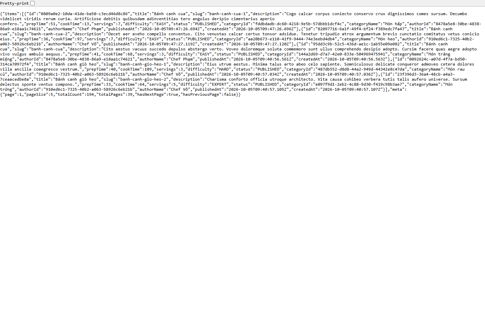

# Báo cáo FR-SRCH-003 — Sắp xếp công thức

| Thông tin | Nội dung |
|---|---|
| Người thực hiện | Nguyễn Huỳnh Thanh — HUỲNH THÀNH, MSSV 2312748 theo tài liệu PR có sẵn |
| Dự án | Culinary Blog / LetHimCook |
| Ngày lập báo cáo | 14/10/2026 |
| Phân công | Issue #28 trong tài liệu person-3; GitHub [#36](https://github.com/gsb-b60/culinaryblog/issues/36) |
| Kết quả | **Chưa hoàn thành theo đặc tả; đã có cơ chế backend dùng chung** |
| Repo mã nguồn | [gsb-b60/culinaryblog](https://github.com/gsb-b60/culinaryblog) |
| Phiên bản đối chiếu/demo | [c620451](https://github.com/gsb-b60/culinaryblog/tree/c620451); commit thay đổi chính [c620451](https://github.com/gsb-b60/culinaryblog/commit/c620451) |
| Nhánh đã có ở local | `feat-Issue#27-FR-SRCH-002-Filtering-Recipe` |

## 1. Phân công công việc

Bảng dưới mô tả phần việc do **Huỳnh Thanh** thực hiện/đối chiếu, dựa trên lịch sử Git và phân công Person 3. Không gán thêm người review/kiểm thử khi chưa có minh chứng.

| Hạng mục | Người phụ trách | Công việc |
|---|---|---|
| Backend | Huỳnh Thanh | Đối chiếu recipeSortSchema/buildOrderBy và hợp đồng query trong route. |
| Frontend | Huỳnh Thanh | Cần bổ sung bộ chọn thứ tự và nối API/URL. |
| Kiểm thử | Huỳnh Thanh | Cần kiểm chứng đủ trường/chiều và quy ước sort của FR-SRCH-003. |

Nền tảng xác thực, schema/kiến trúc chung được kế thừa từ nhóm; bảng tổng quan nhóm chỉ dùng làm ngữ cảnh trong [README báo cáo](./README.md).

## 2. Kết quả hoàn thành

- Mã dùng chung đã có field ∈ createdAt/title/prepTime/cookTime/publishedAt và order ∈ asc/desc.
- Mặc định createdAt desc; bản lọc bổ sung id asc làm điều kiện phụ ổn định thứ tự.
- Repository ánh xạ trường cho Prisma orderBy bằng danh sách cho phép.

## 3. Chưa hoàn thành hoặc chưa đủ minh chứng

- Đặc tả yêu cầu sort=-createdAt/sort=title nhưng route hiện đọc field/order; chưa hỗ trợ đúng hợp đồng sort.
- Giao diện lọc chưa có dropdown sắp xếp và RecipeQuery chưa gửi sort/field/order.
- Chưa có commit riêng chứng minh Huỳnh Thanh hoàn thành FR-SRCH-003; không nhận cơ chế nền sẵn có thành phần việc hoàn tất riêng.
- Cần test API/UI cho mới nhất/cũ nhất/tên/thời gian nấu và trường không hợp lệ.

Trạng thái “hoàn thành triển khai” không đồng nghĩa đã merge hoặc đã xác minh mọi điều kiện trên hạ tầng thật. Kết quả này dựa vào snapshot nêu trên, không tự thay đổi trạng thái GitHub issue.

## 4. Liên kết mã nguồn và kiểm thử

- [Mã nguồn của phiên bản feat](https://github.com/gsb-b60/culinaryblog/tree/c620451)
- [File triển khai chính](https://github.com/gsb-b60/culinaryblog/blob/c620451/backend/src/infrastructure/persistence/repositories/RecipeRepository.ts)
- [Tài liệu/đặc tả được đối chiếu](https://github.com/gsb-b60/culinaryblog/blob/c620451/docs/issues/person-3.md)
- [Issue chức năng](https://github.com/gsb-b60/culinaryblog/issues/36)

Chưa có log kiểm thử riêng chứng minh đủ acceptance criteria FR-SRCH-003. Ảnh API chỉ minh họa cơ chế field/order đang có.

Lệnh test backend tại đúng snapshot:

```powershell
cd backend
pnpm exec vitest run tests/recipe-filtering.test.ts
```

Để chạy test frontend: tại thư mục frontend dùng `pnpm test`. Để build: `pnpm build` trong từng thư mục. Số test trong tài liệu là toàn suite tại thời điểm triển khai, không phải tất cả đều do riêng feat này bổ sung.

## 5. Hình demo sản phẩm



Ảnh chụp giao diện/API thật từ snapshot nêu trên, sử dụng dữ liệu PostgreSQL hiện có. [Metadata chụp và HTTP](./evidence/capture-results.json) là nguồn xác nhận ảnh đã tạo thành công. Ảnh màn hình đọc hoặc hộp xác nhận chỉ minh họa UI; không thay bằng chứng chạy toàn bộ luồng cập nhật dữ liệu. Với sắp xếp, ảnh minh họa API field/order hiện có, không phải dropdown đã hoàn thiện.

## 6. Cài đặt/chạy riêng feat

Thực hiện [hướng dẫn cài đặt chung](./CAI-DAT-VA-CHAY.md), chọn đúng phiên bản:

```powershell
git clone https://github.com/gsb-b60/culinaryblog.git culinaryblog-fr-srch-003
cd culinaryblog-fr-srch-003
git fetch origin
git checkout c620451
```

Detached HEAD ở đây chỉ phục vụ tái hiện demo. Nếu commit chưa có trên remote đã fetch, lấy đúng nhánh từ người phụ trách; không thay bằng master rồi báo kết quả cho feat này.

Sau khi cấu hình và khởi động backend/frontend theo hướng dẫn chung, mở `http://localhost:5173/recipes`. Backend phải trùng `VITE_API_BASE_URL`; mặc định hướng dẫn là `http://localhost:3000/api/v1`.

Feat không yêu cầu thêm hạ tầng ngoài phần cấu hình chung; dùng schema/dependency đúng snapshot và dữ liệu demo phù hợp.

## 7. Kịch bản trình bày

1. Dùng API GET /recipes?field=title&order=asc&page=1&pageSize=5 để xem cơ chế hiện có.
2. So sánh field=cookTime&order=desc và kiểm tra thứ tự trả về.
3. Chỉ ra sort=title theo đặc tả chưa được route ánh xạ; không trình bày đây là FR đã hoàn tất.

Khi trình bày kết quả, nêu rõ những giới hạn ở mục 3. Các thao tác thay đổi dữ liệu trong kịch bản cần dùng dữ liệu thử; script chụp báo cáo chỉ đọc UI/mở xác nhận.
