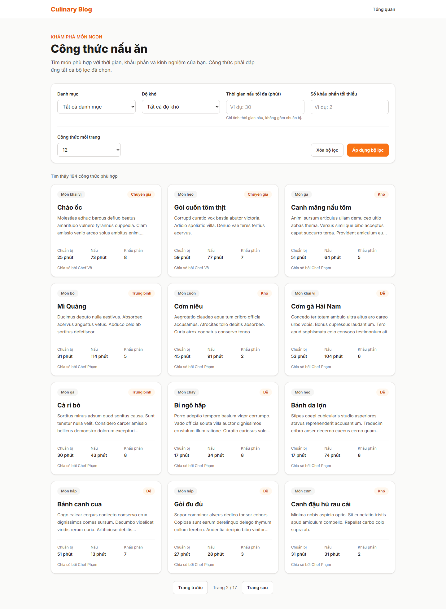

# Báo cáo FR-SRCH-004 — Phân trang

| Thông tin | Nội dung |
|---|---|
| Người thực hiện | Nguyễn Huỳnh Thanh — HUỲNH THÀNH, MSSV 2312748 theo tài liệu PR có sẵn |
| Dự án | Culinary Blog / LetHimCook |
| Ngày lập báo cáo | 14/10/2026 |
| Phân công | Issue #29 trong tài liệu person-3; GitHub [#37](https://github.com/gsb-b60/culinaryblog/issues/37) |
| Kết quả | **Đã triển khai trong feat lọc; chưa xác minh đầy đủ tiêu chí độc lập** |
| Repo mã nguồn | [gsb-b60/culinaryblog](https://github.com/gsb-b60/culinaryblog) |
| Phiên bản đối chiếu/demo | [c620451](https://github.com/gsb-b60/culinaryblog/tree/c620451); commit thay đổi chính [c620451](https://github.com/gsb-b60/culinaryblog/commit/c620451) |
| Nhánh đã có ở local | `feat-Issue#27-FR-SRCH-002-Filtering-Recipe` |

## 1. Phân công công việc

Bảng dưới mô tả phần việc do **Huỳnh Thanh** thực hiện/đối chiếu, dựa trên lịch sử Git và phân công Person 3. Không gán thêm người review/kiểm thử khi chưa có minh chứng.

| Hạng mục | Người phụ trách | Công việc |
|---|---|---|
| Backend | Huỳnh Thanh | Chuẩn hóa page/pageSize, skip/take, COUNT và metadata phân trang. |
| Frontend | Huỳnh Thanh | Nút trước/sau, số trang, chọn kích thước, giữ bộ lọc trên URL. |
| Kiểm thử | Huỳnh Thanh | Dùng test trong feat lọc; cần bổ sung bằng chứng đủ trường hợp biên riêng FR-SRCH-004. |

Nền tảng xác thực, schema/kiến trúc chung được kế thừa từ nhóm; bảng tổng quan nhóm chỉ dùng làm ngữ cảnh trong [README báo cáo](./README.md).

## 2. Kết quả hoàn thành

- page mặc định 1, pageSize mặc định 12; page phải dương, pageSize từ 1 đến 50.
- skip=(page-1)*pageSize; take=pageSize; COUNT dùng cùng điều kiện lọc.
- Response có items và meta: page/pageSize/totalCount/totalPages/hasNextPage/hasPreviousPage.
- UI trước/sau và chọn 12/24/48; chuyển trang giữ bộ lọc, áp dụng lọc về trang 1.
- Thứ tự có điều kiện phụ id để tránh trùng vị trí do createdAt bằng nhau khi dữ liệu không đổi.

## 3. Chưa hoàn thành hoặc chưa đủ minh chứng

- Chưa có báo cáo kiểm thử độc lập đủ trang cuối, vượt phạm vi, ranh giới flags và mọi endpoint danh sách.
- Playwright chỉ kiểm tra trang 2 khi dữ liệu hơn 12 món; cần ghi nhận điều kiện dataset khi chạy.
- Phân trang offset có thể dịch chuyển khi dữ liệu được thêm/xóa giữa hai request.
- Chưa có nhánh/commit riêng cho FR-SRCH-004 và chưa xác nhận merge master.

Trạng thái “hoàn thành triển khai” không đồng nghĩa đã merge hoặc đã xác minh mọi điều kiện trên hạ tầng thật. Kết quả này dựa vào snapshot nêu trên, không tự thay đổi trạng thái GitHub issue.

## 4. Liên kết mã nguồn và kiểm thử

- [Mã nguồn của phiên bản feat](https://github.com/gsb-b60/culinaryblog/tree/c620451)
- [File triển khai chính](https://github.com/gsb-b60/culinaryblog/blob/c620451/backend/src/application/dtos/PagedResult.ts)
- [Tài liệu/đặc tả được đối chiếu](https://github.com/gsb-b60/culinaryblog/blob/c620451/docs/recipe-filtering-e2e.md)
- [Issue chức năng](https://github.com/gsb-b60/culinaryblog/issues/37)

Có kiểm tra phân trang trong recipe-filtering.test.ts và e2e/recipe-filtering.spec.ts tại c620451. Chưa gán toàn bộ kết quả của feat lọc thành chứng nhận độc lập cho FR-SRCH-004.

Lệnh test backend tại đúng snapshot:

```powershell
cd backend
pnpm exec vitest run tests/recipe-filtering.test.ts
```

Để chạy test frontend: tại thư mục frontend dùng `pnpm test`. Để build: `pnpm build` trong từng thư mục. Số test trong tài liệu là toàn suite tại thời điểm triển khai, không phải tất cả đều do riêng feat này bổ sung.

## 5. Hình demo sản phẩm



Ảnh chụp giao diện/API thật từ snapshot nêu trên, sử dụng dữ liệu PostgreSQL hiện có. [Metadata chụp và HTTP](./evidence/capture-results.json) là nguồn xác nhận ảnh đã tạo thành công. Ảnh màn hình đọc hoặc hộp xác nhận chỉ minh họa UI; không thay bằng chứng chạy toàn bộ luồng cập nhật dữ liệu. Với sắp xếp, ảnh minh họa API field/order hiện có, không phải dropdown đã hoàn thiện.

## 6. Cài đặt/chạy riêng feat

Thực hiện [hướng dẫn cài đặt chung](./CAI-DAT-VA-CHAY.md), chọn đúng phiên bản:

```powershell
git clone https://github.com/gsb-b60/culinaryblog.git culinaryblog-fr-srch-004
cd culinaryblog-fr-srch-004
git fetch origin
git checkout c620451
```

Detached HEAD ở đây chỉ phục vụ tái hiện demo. Nếu commit chưa có trên remote đã fetch, lấy đúng nhánh từ người phụ trách; không thay bằng master rồi báo kết quả cho feat này.

Sau khi cấu hình và khởi động backend/frontend theo hướng dẫn chung, mở `http://localhost:5173/recipes`. Backend phải trùng `VITE_API_BASE_URL`; mặc định hướng dẫn là `http://localhost:3000/api/v1`.

Feat không yêu cầu thêm hạ tầng ngoài phần cấu hình chung; dùng schema/dependency đúng snapshot và dữ liệu demo phù hợp.

## 7. Kịch bản trình bày

1. Mở /recipes với tập dữ liệu nhiều hơn 12 món và kiểm tra tổng số/trang.
2. Chuyển Trang sau: URL page=2, danh sách khác trang 1; quay lại bằng Back.
3. Đổi pageSize, áp dụng rồi kiểm tra về trang 1 và tổng số không đổi khi bộ lọc không đổi.
4. Kiểm tra API page=0/pageSize=51 trả 422; trang rất lớn trả 200 với items rỗng.

Khi trình bày kết quả, nêu rõ những giới hạn ở mục 3. Các thao tác thay đổi dữ liệu trong kịch bản cần dùng dữ liệu thử; script chụp báo cáo chỉ đọc UI/mở xác nhận.
