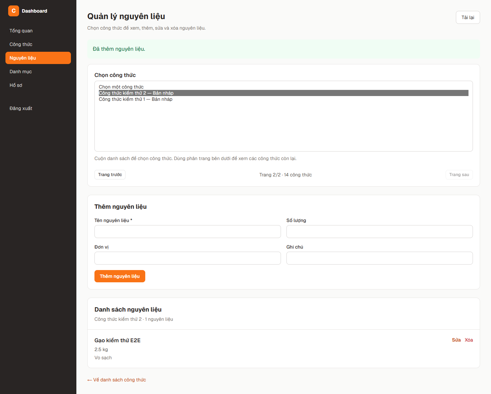
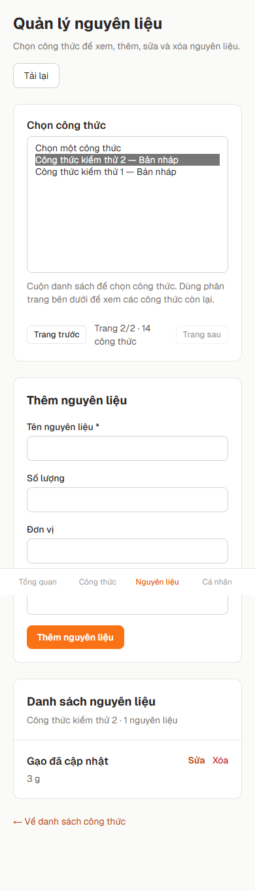

# FR-RCP-009 — Tích hợp quản lý nguyên liệu với master mới

Ngày kiểm tra: **21/10/2026**. Nhánh bàn giao: **feat-frontend-add/delete/fix-ingredient-management**. Bản tích hợp nguồn: **feat/integrate-ingredients-master tại fc4de45**. Nền tảng: **origin/master tại 1ed7022** sau `git fetch origin --prune`; master local và origin/master không lệch commit. Repo hiện không có nhánh main.

Bản tích hợp đã được lưu tại fc4de45 và đưa về nhánh nguyên liệu cũ bằng merge, giữ lịch sử cả hai nhánh. Chưa push trong lần cập nhật này và chưa merge vào master. Các báo cáo snapshot ngày 14/10 được giữ tại nhánh tài liệu riêng `docs/huynh-thanh-review-snapshots`; không dùng kết quả cũ để khẳng định trạng thái master hiện tại.

## 1. Những điểm thay đổi theo master

| Phần | Nhánh nguyên liệu cũ | Bản tích hợp mới |
|---|---|---|
| Layout | Trang tự chứa sidebar/logout | Dùng DashboardLayout và DashboardSidebar chung |
| Đăng nhập | Đọc trực tiếp loadSession | Dùng Zustand useAuthStore và token cập nhật tại thời điểm gọi API |
| Danh sách công thức | /recipes/manageable | Tái sử dụng /recipes/manage?page=...&pageSize=12 của master |
| Kiểu dữ liệu | Kiểu riêng trong api.ts | Dùng RecipePage, RecipeIngredient và CreateIngredientPayload của master |
| Truy cập | Route standalone | Route /dashboard/ingredients trong DashboardLayout |
| Liên kết | Menu trang cũ | Menu desktop/mobile và nút Nguyên liệu ở mỗi công thức |
| Quyền CRUD | Middleware so sánh recipeId với userId gây chặn nhầm | Handler kiểm tra authorId thật của công thức, cho phép Admin |
| Đọc nguyên liệu | Master chưa có GET | Bổ sung query/handler và GET /recipes/{id}/ingredients |
| Scalar | CRUD nguyên liệu thiếu body và GET | Bổ sung GET, request body POST/PUT, response schema và mã lỗi |

Không thay phần xuất bản/hủy xuất bản, lưu trữ, xóa công thức, quản lý bước nấu hoặc lọc/sắp xếp của các FR khác.

## 2. Cách mở chức năng

Trong workspace hiện tại:

```powershell
# Terminal 1, từ thư mục gốc
docker compose up -d postgres redis
cd backend
pnpm install
pnpm prisma:generate
pnpm dev
```

```powershell
# Terminal 2, từ thư mục gốc
cd frontend
pnpm install
pnpm dev
```

Nếu database chưa có schema, khởi tạo theo hướng dẫn của dự án; không chạy reset database đang có dữ liệu. Cấu hình local đã đối chiếu: backend PORT=3000, frontend VITE_API_BASE_URL=http://localhost:3000/api/v1, CORS cho localhost:5173. Không sửa các file .env.

Đăng nhập Author/Admin rồi mở http://localhost:5173/dashboard/ingredients hoặc chọn **Nguyên liệu** trong dashboard. Trong **Công thức**, mỗi công thức có liên kết **Nguyên liệu** dẫn đến đúng công thức và trang phân trang hiện tại. Author chỉ thấy công thức của mình; Admin có thể quản lý các tác giả khác.

Form hỗ trợ tên, lượng, đơn vị và ghi chú. Khi sửa, để trống lượng giữ nguyên giá trị cũ; đơn vị và ghi chú có thể xóa bằng chuỗi rỗng. Các nút bị khóa khi đang lưu, có xác nhận trước khi xóa, thông báo thành công/lỗi và nút tải lại. Việc thêm gán orderIndex = max hiện tại + 1.

Nếu dev server đã chạy từ trước, tải lại trình duyệt; khởi động lại backend nếu tiến trình hiện tại không tự nạp thay đổi source.

## 3. API và Scalar

- GET /api/v1/recipes/manage?page=1&pageSize=12 — danh sách công thức dùng chung với master.
- GET /api/v1/recipes/{id}/ingredients — 200, nguyên liệu chưa xóa theo orderIndex/createdAt/id.
- POST /api/v1/recipes/{id}/ingredients — 201, trả RecipeIngredient.
- PUT /api/v1/recipes/{id}/ingredients/{ingredientId} — 200, trả RecipeIngredient đã cập nhật.
- DELETE /api/v1/recipes/{id}/ingredients/{ingredientId} — 204, soft delete.

Dùng Bearer JWT. Thiếu token: 401; không phải owner/Admin: 403; công thức/nguyên liệu không tồn tại hoặc nguyên liệu thuộc công thức khác: 404; dữ liệu sai: 422. Tên được trim trước validation. Không thay đổi schema Prisma.

Master mới đã có Scalar tại http://localhost:3000/scalar và OpenAPI tại /api-docs.json. Các API nguyên liệu đã được bổ sung mô tả body/response để thử trực tiếp trên Scalar.

## 4. Kiểm thử thực tế

| Kiểm tra | Kết quả lần chạy này |
|---|---|
| PostgreSQL/HTTP/JWT integration | 7/7 passed |
| Toàn bộ test backend | 202/202 test passed |
| Backend pnpm test (có coverage) | Passed: coverage 89,23% ≥ ngưỡng 80% |
| TypeScript backend | Passed |
| Lint file backend thay đổi | 0 errors; 2 warnings có sẵn tại container và 42 warnings có sẵn tại infrastructure/config |
| Frontend pnpm test --maxWorkers=2 | 160/160 passed |
| Frontend pnpm build | Passed; có cảnh báo bundle >500 kB |
| Frontend pnpm lint | Passed |
| Edge desktop/mobile + API/PostgreSQL thật | Passed |

Bộ test frontend cũ có fixture UTC nửa đêm nhưng kỳ vọng ngày local, khiến sai ngày ở America/Los_Angeles. Đã đổi fixture sang ISO của một ngày local cụ thể, không đổi code định dạng ngày sản phẩm. Lần chạy mặc định có worker timeout khi nhiều tiến trình khởi động; chạy lại với 2 worker hoàn tất toàn suite.

Không hạ ngưỡng coverage hoặc loại file khỏi coverage. Lần kiểm tra đầu trên master mới có 162 test pass nhưng coverage chỉ 58,89%. Sau yêu cầu bổ sung kiểm thử, đã chuyển 18 test domain và 22 test dịch vụ thật sang code mới, chạy lại toàn suite và đạt 202/202 test, coverage 89,23%. Kết quả 160 test/84,69% của nhánh cũ chỉ là dữ liệu lịch sử.

### Lệnh chạy lại

```powershell
cd backend
pnpm exec vitest run tests/ingredients-master.integration.test.ts
pnpm exec tsc --noEmit
pnpm test
```

```powershell
cd frontend
pnpm test --maxWorkers=2
pnpm build
pnpm lint
```

### Kiểm thử trình duyệt thật

Cần cài dependency cả frontend và backend. Script dùng Microsoft Edge headless trên Windows; cần Edge đã được cài.

```powershell
cd backend
pnpm test:e2e:ingredients
```

Script tạo schema PostgreSQL có tên ingredient_test_<uuid>, khởi động backend test ở cổng ngẫu nhiên và Vite ở 5187. Nó dùng route, Command Bus, handler, JWT và PostgreSQL thật; không intercept/mock API. Dữ liệu ứng dụng nằm ngoài schema thử nghiệm không bị sửa. Cuối bài kiểm tra dừng server và chỉ xóa schema do chính test tạo. Nếu kill tiến trình trước teardown, cần kiểm tra tên schema trước khi dọn.

Kịch bản đã xác nhận: đi từ công thức ở trang 2 đến nguyên liệu đúng công thức; sidebar duy nhất và mục đang chọn; POST 201, PUT 200, tải lại còn dữ liệu; DELETE 204 và isDeleted=true trong PostgreSQL; mobile navigation; refresh token thật.





[Kết quả E2E và mã HTTP](./evidence/ingredients-master/result.json) không lưu JWT/password. Ảnh và kết quả phản ánh source tích hợp tại thời điểm chạy, chưa phải commit được merge trên GitHub.

## 5. File chính

- frontend/src/pages/IngredientManagementPage.tsx
- frontend/src/components/DashboardSidebar.tsx
- frontend/src/components/layout/DashboardLayout.tsx
- frontend/src/pages/RecipesPage.tsx
- frontend/src/App.tsx
- frontend/src/lib/api.ts
- backend/src/application/handlers/RecipeIngredientQueryHandler.ts
- backend/src/presentation/di/container.ts
- backend/src/presentation/routes/recipeRoutes.ts
- backend/src/presentation/docs/openapi.ts
- backend/tests/ingredients-master.integration.test.ts
- backend/tests/support/ingredientIntegration.ts
- backend/tests/ingredients-master.e2e.ts

Báo cáo/ảnh các chức năng khác và script snapshot đã được tách khỏi PR nguyên liệu theo review; bản đầy đủ được bảo toàn ở nhánh tài liệu riêng.

## 6. Cập nhật coverage đạt yêu cầu — 21/10/2026

Lệnh `pnpm test` chạy thật trên nhánh tích hợp đã hoàn tất **exit code 0**, với **18 test files passed**, **202 tests passed** và **89,23% lines coverage**. Ngưỡng vẫn là **80%** trên toàn bộ phạm vi source đã cấu hình.

Test mới dùng PostgreSQL, Redis, MinIO, MailHog và BullMQ thật với tài nguyên riêng được dọn sau mỗi lần chạy. Các sửa lỗi Prisma/SMTP đã xác minh ở nhánh trước được áp dụng lại cho master mới; queue và worker có BULLMQ_PREFIX mặc định bull, riêng test dùng prefix ngẫu nhiên để tránh xử lý job của ứng dụng.

[Hướng dẫn chạy test dịch vụ thật](../../../backend/TESTING_REAL_SERVICES.md) và [kết quả coverage](./evidence/ingredients-master/coverage-result.json). HTML report nằm tại backend/coverage/index.html sau khi chạy test. Kết quả này thuộc lần kiểm tra tích hợp trước review; xem mục cập nhật sau review bên dưới.
## 7. Bàn giao trên nhánh frontend-add/delete/fix

Nhánh `feat-frontend-add/delete/fix-ingredient-management` nhận bản tích hợp tại `fc4de45` bằng merge, bao gồm nền master `1ed7022`. Khi xử lý xung đột, dùng API `/recipes/manage`, DashboardLayout và Zustand từ bản tích hợp thay cho cấu trúc cũ.

Kết quả chạy lại trên nhánh bàn giao ngày 21/10/2026:

- Backend `pnpm test`: 18 files, 202/202 tests passed; coverage dòng code 89,23%, giữ nguyên ngưỡng 80%.
- Frontend `pnpm test --maxWorkers=2`: 17 files, 160/160 tests passed. Lần chạy song song với build gặp timeout khởi động worker; chạy riêng toàn bộ suite sau đó đã pass.
- Backend và frontend `pnpm build`: pass. Frontend build bao gồm kiểm tra TypeScript.
- Frontend `pnpm lint`: pass. Backend `pnpm lint`: exit 0, 0 errors, 197 warnings; chưa phải lint clean hoàn toàn.
- Bản sao backend không có `.env`: 29/29 test tích hợp với dịch vụ thật pass, cấu hình qua biến môi trường.
- Image MinIO dùng cho CI đã xác minh manifest và khởi động thử container riêng, health endpoint trả 200. Container kiểm tra đã được dọn.

Workflow chạy khi push nhánh này và khi tạo PR vào master; backend chạy test có coverage với PostgreSQL/Redis/MinIO/MailHog thật. Sau khi push, xem GitHub → Actions → CI hoặc tab Checks của PR. Chưa xác nhận kết quả runner GitHub trong lần kiểm tra local này.

## 8. Xử lý review PR #55

- Đồng bộ `recipeId` và `page` với URL; URL là nguồn lựa chọn hiện tại nên tải lại giữ đúng công thức/trang và không còn ref bị thay đổi trong updater state.
- Xóa trạng thái tải nguyên liệu khi bỏ chọn/chuyển trang; bỏ qua sự kiện chọn lại cùng công thức để tránh khóa form.
- E2E dùng Chromium mặc định, hỗ trợ biến `E2E_BROWSER_CHANNEL=msedge` khi cần Edge. Đã kiểm tra hồi quy bằng Edge thật, HTTP và PostgreSQL thật; dùng CDP ngắt kết nối mạng trong kịch bản lỗi, không giả API/dịch vụ.
- Thêm ảnh HTTP response thật 201/200/204 từ E2E. Panel trong ảnh là bản hiển thị method/path/status/body do trình duyệt nhận, không phải ảnh Scalar/DevTools.
- Thêm JSDoc cho 76 hàm/constructor chưa có mô tả trong các file source thuộc PR. Đây là kiểm tra tài liệu hàm, độc lập với test coverage. Chờ CodeRabbit tính lại tỷ lệ trên diff mới sau push.
- Báo cáo/ảnh đa chức năng và script capture-demo được tách sang nhánh local `docs/huynh-thanh-review-snapshots`, commit `7f49a92`. Trên nhánh đó đã sửa `fileURLToPath`, `list.data.items`, bảo vệ env và ghi rõ mốc master lịch sử; chưa chạy lại toàn bộ snapshot lịch sử.
- Giữ Playwright vì E2E của FR-RCP-009 trực tiếp dùng thư viện này; không giữ dependency chỉ để chụp các chức năng khác.

[Kết quả E2E mới](./evidence/ingredients-master/result.json) · [POST 201](./evidence/ingredients-master/api-post-201.png) · [PUT 200](./evidence/ingredients-master/api-put-200.png) · [DELETE 204](./evidence/ingredients-master/api-delete-204.png).

### Kết quả cuối sau sửa review

Backend: 202 tests pass, lines coverage 89,23%; frontend: 160 tests pass. Lint/build cả hai phía exit 0; backend còn 197 warnings. E2E thực chạy bằng Edge cấu hình qua biến môi trường đã pass toàn bộ hồi quy. [Metadata](./evidence/ingredients-master/review-validation.json), [log backend](./evidence/ingredients-master/validation-backend.txt), [log frontend](./evidence/ingredients-master/validation-frontend.txt). Ảnh validation là bản render trích đoạn log thật, không phải chụp terminal. Chưa xác nhận lại GitHub Actions/CodeRabbit sau các thay đổi này.
