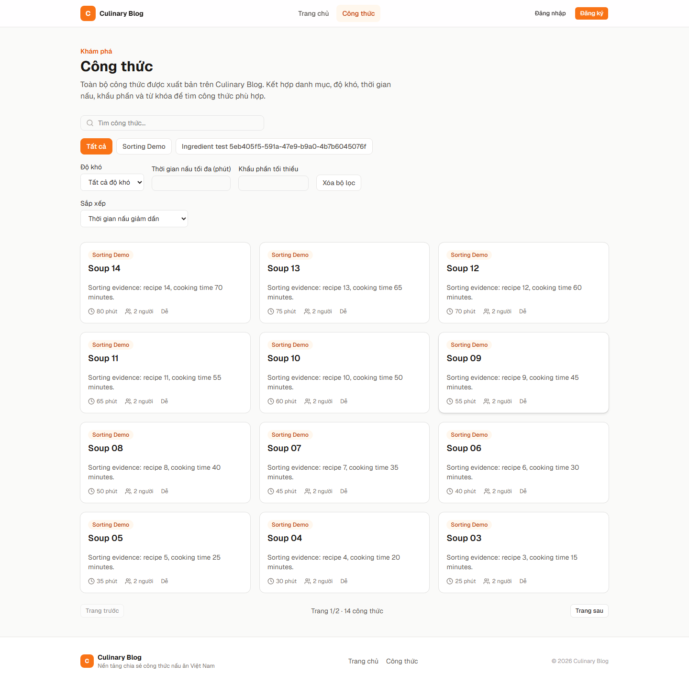
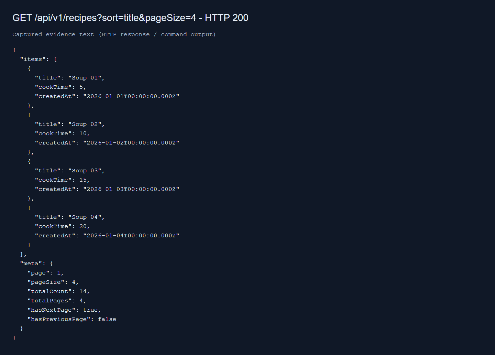
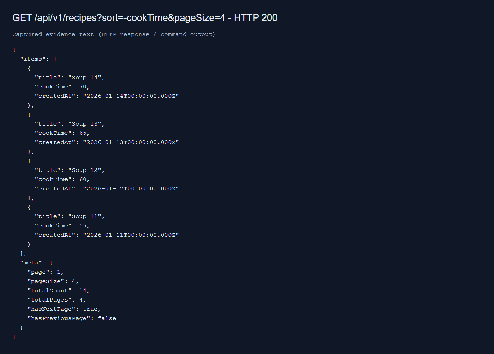
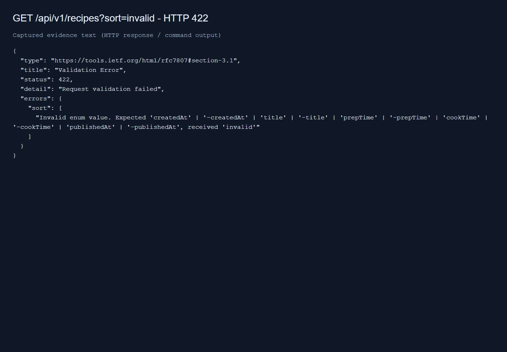
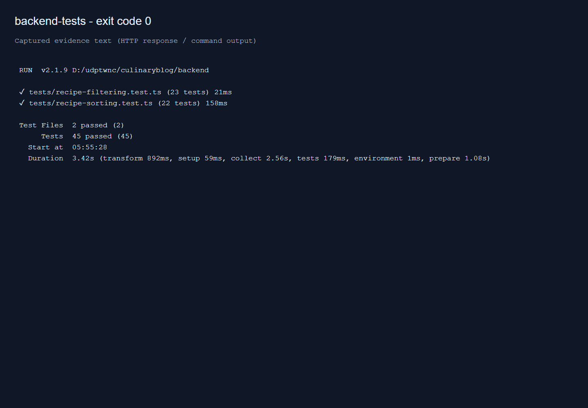
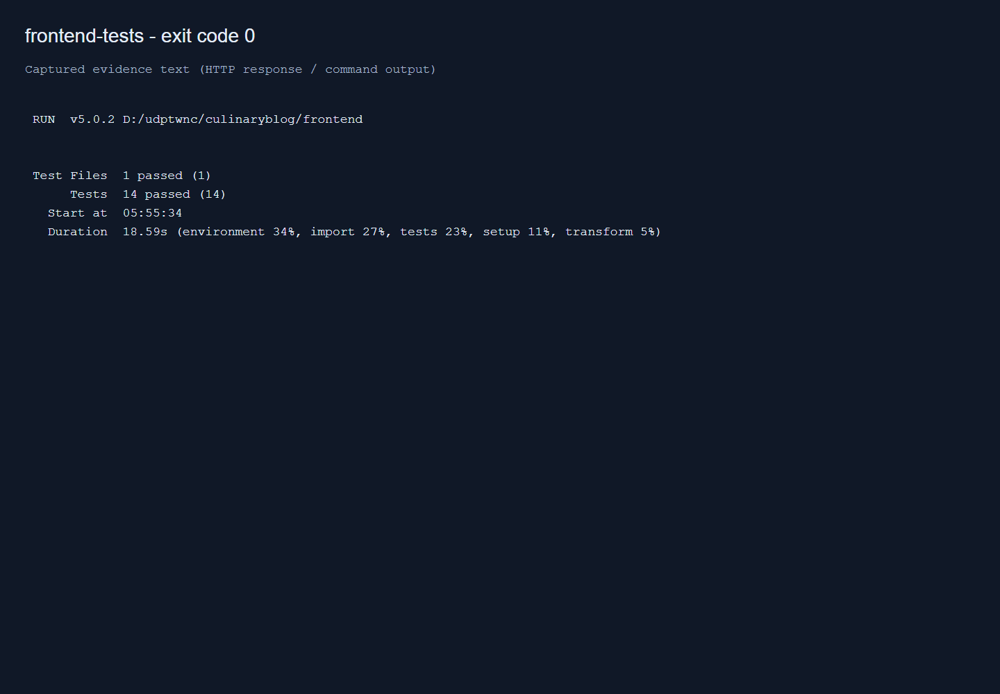
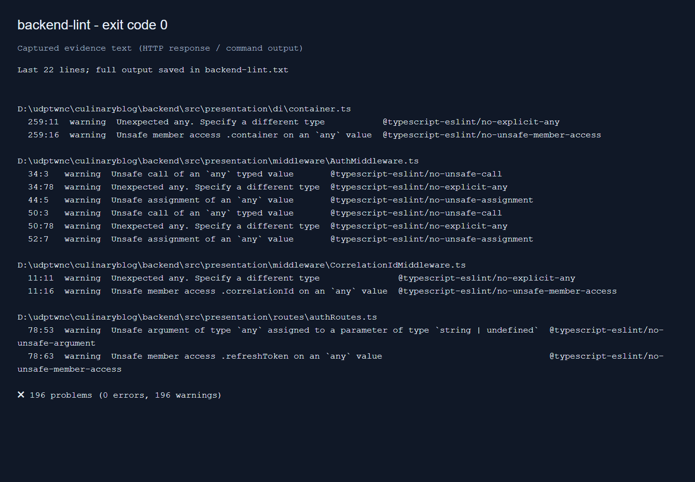
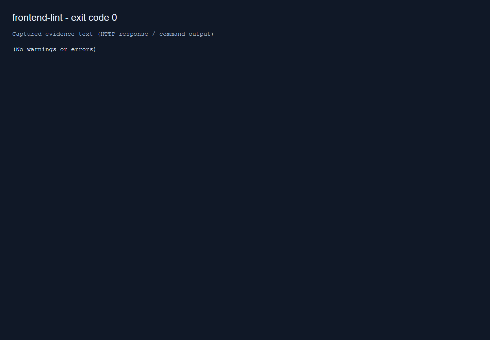
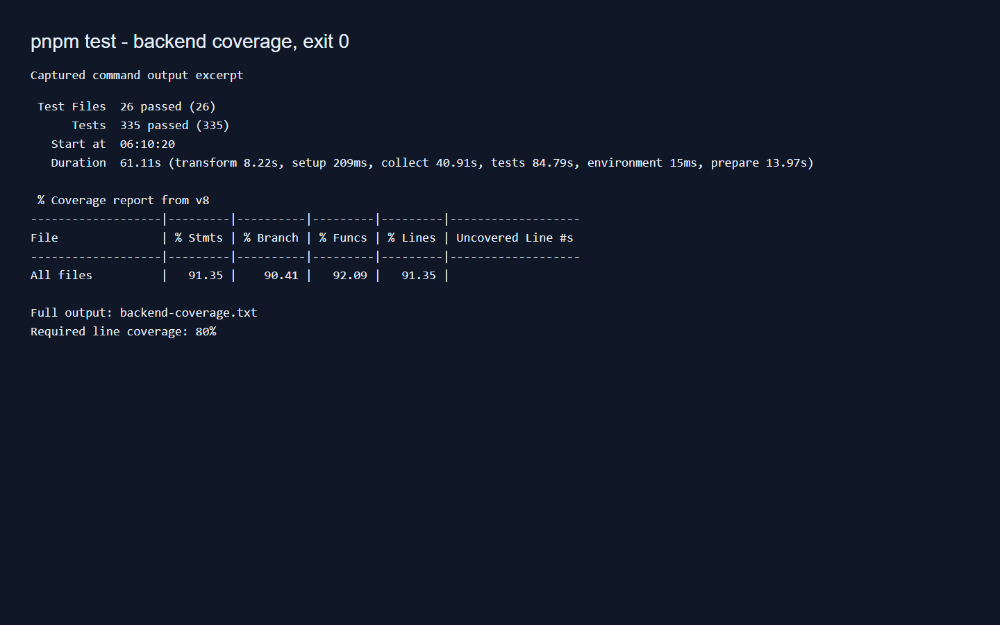
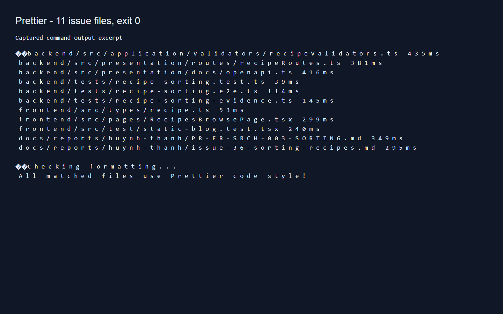

## 1. Thông tin thành viên

| Họ tên             | MSSV    | Vai trò                        |
| ------------------ | ------- | ------------------------------ |
| Nguyễn Huỳnh Thanh | 2312748 | Fullstack (Backend / Frontend) |

---

## 2. FR name

FR-SRCH-003 - Sorting Recipes

Tham chiếu: `docs/03-fr-misc.md` §3.4 — Search & Pagination Module.

---

## 3. Issue name

Issue #28 — FR-SRCH-003: Sorting Recipes

**Link:** [docs/issues/person-3.md — Issue #28](https://github.com/gsb-b60/culinaryblog/blob/feat-issue%2328-FR-SRCH-003-Sorting-Recipes/docs/issues/person-3.md#issue-28--fr-srch-003-sorting-recipes)

Closes #36

Số #28 là thứ tự trong tài liệu phân công; số issue trên GitHub là #36.

---

## 4. Mô tả thay đổi

Hoàn thiện sắp xếp công thức công khai qua `sort={field}`: dấu `-` tương ứng giảm dần, không có dấu là tăng dần, mặc định `-createdAt`. Bổ sung dropdown tại trang `/recipes` và dùng lại pipeline truy vấn, lọc và phân trang hiện có.

- Whitelist: `createdAt`, `title`, `prepTime`, `cookTime`, `publishedAt`; mỗi trường hỗ trợ hai chiều.
- Query sort rỗng, sai trường, lặp hoặc dạng object trả 422 trước khi truy vấn dữ liệu.
- Giữ tương thích `field/order`; các tham số cũ vẫn được validate, `sort` hợp lệ được ưu tiên.
- Áp dụng cùng parser cho danh sách và endpoint tìm kiếm.
- Dropdown lưu lựa chọn vào URL, giữ bộ lọc/từ khóa, về trang 1 khi đổi sắp xếp và khôi phục khi reload/Back/Forward.
- Giữ thứ tự phụ `id ASC` hiện có để phân trang ổn định khi giá trị sắp xếp bằng nhau.
- Bổ sung test, E2E PostgreSQL thật, ảnh desktop và bằng chứng response/log.

| File chính                                               | Thay đổi                                             |
| -------------------------------------------------------- | ---------------------------------------------------- |
| `backend/src/application/validators/recipeValidators.ts` | Parse và whitelist tham số sort                      |
| `backend/src/presentation/routes/recipeRoutes.ts`        | Áp dụng vào danh sách và tìm kiếm                    |
| `backend/src/presentation/docs/openapi.ts`               | Mô tả sort, mặc định và lỗi 422                      |
| `frontend/src/types/recipe.ts`                           | Kiểu query và lựa chọn sắp xếp                       |
| `frontend/src/pages/RecipesBrowsePage.tsx`               | Dropdown, URL state và reset phân trang              |
| `backend/tests/recipe-sorting.test.ts`                   | 22 test hồi quy HTTP → handler → repository          |
| `backend/tests/recipe-sorting.e2e.ts`                    | Kiểm tra thứ tự thực tế và phân trang với PostgreSQL |
| `backend/tests/recipe-sorting-evidence.ts`               | Chụp ảnh trình duyệt, API và đầu ra test/lint        |
| `frontend/src/test/static-blog.test.tsx`                 | Khôi phục sort, query gửi đi, giữ bộ lọc và fallback |
| `docs/reports/huynh-thanh/evidence/fr-srch-003/`         | PNG, JSON và log gốc                                 |

---

## 5. Phạm vi

- [x] backend
- [x] frontend
- [ ] prisma-DB (schema / migration / seed)
- [ ] infra-docker (docker-compose, nginx, redis, minio)
- [x] docs

**Layer (backend):**

- [ ] domain
- [x] application
- [ ] infrastructure
- [x] presentation

Không sửa domain/repository hoặc Prisma schema. Dùng lại `RecipeSortOptions` và `orderBy` hiện có. Dữ liệu E2E nằm trong schema riêng, được dọn sau kiểm thử.

---

## 6. Cách kiểm thử

1. Khởi động hạ tầng local: `docker-compose up -d`.
2. Backend: trong `backend`, cài dependencies và cấu hình env theo README nếu chưa có; chạy `pnpm dev`.
3. Frontend: trong `frontend`, chạy `pnpm dev`; mở `http://localhost:5173/recipes`. API base URL phải trỏ đúng backend local.
4. Chọn **Tên A–Z**, **Cũ nhất**, **Thời gian nấu giảm dần**; đối chiếu thứ tự trong response Network. Thời gian trên thẻ là prepTime+cookTime; sắp xếp thời gian nấu chỉ dùng cookTime.
5. Chọn bộ lọc và đổi sort: bộ lọc được giữ; đổi sort từ trang 2 về trang 1; reload và Back/Forward khôi phục lựa chọn.
6. Kiểm tra API, thay cổng 3000 nếu backend local dùng cổng khác:

   ```powershell
   curl.exe "http://localhost:3000/api/v1/recipes?sort=title"
   curl.exe "http://localhost:3000/api/v1/recipes?sort=-cookTime"
   curl.exe -i "http://localhost:3000/api/v1/recipes?sort=invalid"
   ```

   Hai request đầu trả 200 và items đúng thứ tự; request cuối trả 422 Problem Details.

7. Trong `backend`:

   ```powershell
   pnpm exec vitest run tests/recipe-sorting.test.ts tests/recipe-filtering.test.ts
   pnpm exec tsx tests/recipe-sorting.e2e.ts
   pnpm exec tsx tests/recipe-sorting-evidence.ts
   pnpm exec vitest run
   pnpm lint
   pnpm build
   ```

8. Trong `frontend`:

   ```powershell
   pnpm exec vitest run --maxWorkers=2
   pnpm lint
   pnpm build
   ```

**Kết quả đã xác minh trước khi bổ sung ảnh:**

| Kiểm tra                               | Kết quả                                                    |
| -------------------------------------- | ---------------------------------------------------------- |
| Backend toàn bộ Vitest                 | 335/335 test, 26 file pass                                 |
| Frontend toàn bộ Vitest, 2 worker      | 242/242 test, 25 file pass                                 |
| Backend test riêng sorting + filtering | 45/45 pass                                                 |
| E2E PostgreSQL riêng sorting           | 5 trường hợp thứ tự, tìm kiếm, lỗi sort và phân trang pass |
| Backend/frontend build                 | Pass                                                       |
| Backend lint                           | Exit 0, 0 errors, 196 warnings                             |
| Frontend lint                          | Pass                                                       |
| git diff --check                       | Pass                                                       |

Lần chạy frontend đồng thời với nhiều kiểm tra từng gặp một test dashboard timeout 5 giây; chạy lại toàn bộ với 2 worker đạt 242/242, không sửa test hoặc timeout. Các lệnh thực tế dùng npm/npx tương ứng. Lần kiểm tra bổ sung đã chạy `pnpm test` backend có coverage: 335/335 test pass, lines/statements 91,35%, branches 90,41%, functions 92,09%; vượt ngưỡng lines 80%. Đã chạy `pnpm prisma:generate` thành công. Prettier đã áp dụng cho các file issue #36; kiểm tra toàn repo bị chặn bởi HTML có sẵn ở `web-showcase.html:280`, nên bỏ qua format toàn repo. Frontend build còn cảnh báo bundle >500 kB.

Script chụp ảnh cần PostgreSQL/Redis local, Chromium Playwright và cổng 5187 trống; chạy Vite/HTTP thật, không mock API. Dữ liệu Soup 01–14 là fixture minh chứng để dễ đối chiếu thứ tự.

---

Lần tạo snapshot đã chạy lại: backend 45/45 test, frontend 14/14 test và lint hai phía exit 0; 9 nhóm kiểm tra API/browser/log đều pass, không có page error. Kết quả nằm trong `evidence/fr-srch-003/result.json`.

## 7. Screenshot minh chứng thành công (BẮT BUỘC)

Ảnh desktop được chụp từ Chromium với API và PostgreSQL thật. Ảnh API/test/lint là trang hiển thị dữ liệu HTTP và đầu ra lệnh đã thu được, không phải ảnh Scalar hay terminal hệ điều hành. Ảnh API 200 chỉ hiển thị title/cookTime/createdAt/meta cho dễ đọc; file JSON giữ đầy đủ response.

**1. Desktop — Tên A–Z, Soup 01 đứng đầu:**


**2. Desktop — thời gian nấu giảm dần, Soup 14 đứng đầu:**



**3. API 200 — sort=title:**



**4. API 200 — sort=-cookTime:**



**5. API 422 — sort không hợp lệ:**



**6. Test backend sorting + filtering:**



**7. Test frontend trang công thức:**



**8. Lint backend — exit 0, còn 196 warnings (ảnh trích cuối log):**



**9. Lint frontend — exit 0:**



**10. Backend coverage — 335/335 test pass, lines 91,35%:**



**11. Prisma generate — tạo Prisma Client thành công:**


**12. Prettier — các file issue #36 đạt kiểm tra định dạng:**



Log và kết quả máy đọc: `docs/reports/huynh-thanh/evidence/fr-srch-003/` gồm `result.json`, `api-title.json`, `api-cook-time.json`, `api-422.json` và các file `.txt`.

Ảnh trong mô tả PR chỉ tải được sau khi push thư mục evidence lên nhánh tương ứng. Repo riêng tư có thể cần kéo thả PNG trực tiếp vào PR nếu raw image không hiển thị.

---

## 8. Checklist

- [x] Lint pass backend + frontend (backend có 196 warnings, 0 errors)
- [x] Build / TypeScript pass
- [x] Vitest pass: backend 335 test có coverage, frontend 242 test
- [x] `pnpm test` backend với coverage — 335/335 test pass, lines/statements 91,35%, branches 90,41%, functions 92,09%; vượt ngưỡng lines 80%
- [x] `pnpm prisma:generate` — đã chạy thành công, Prisma Client 5.22.0; không đổi schema/database
- [x] Không đưa .env, secrets, keys hoặc token vào thay đổi issue
- [x] Prettier các file của issue #36 — đã format và kiểm tra
- [ ] Format Prettier toàn repo — đã kiểm tra nhưng không hoàn tất: `web-showcase.html:280` có thẻ `div` đóng không hợp lệ; bỏ qua theo phạm vi yêu cầu
- [x] Đã tự review code và đối chiếu acceptance criteria
- [x] Không thêm console/debug thừa vào mã ứng dụng; script kiểm thử có log kết quả
- [x] Documentation và mô tả API cập nhật
