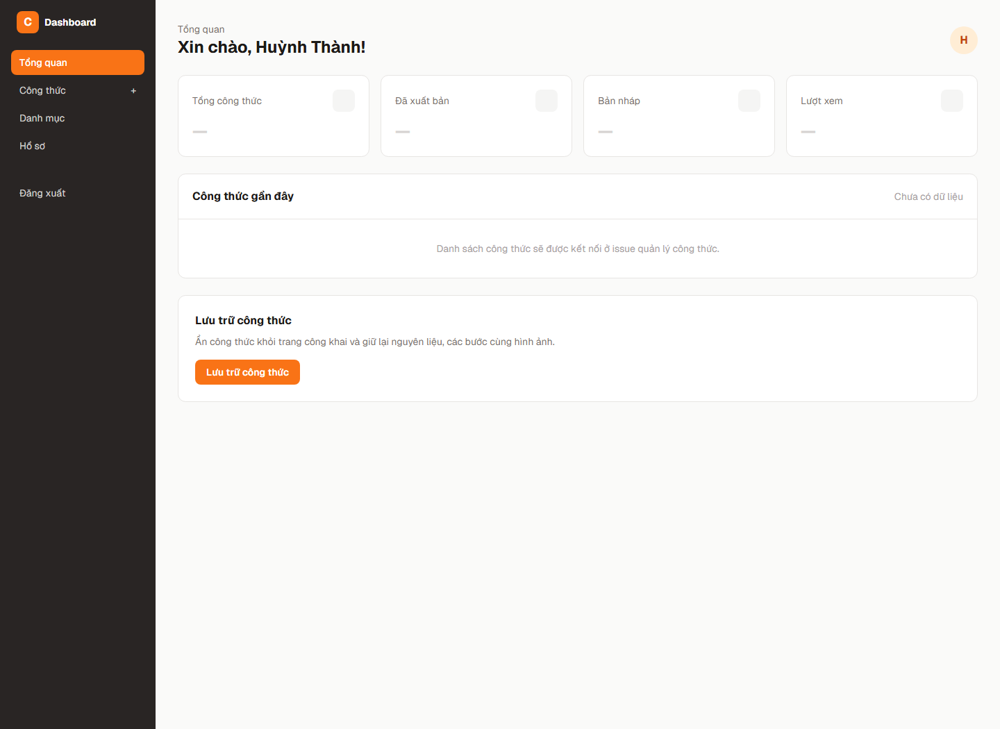
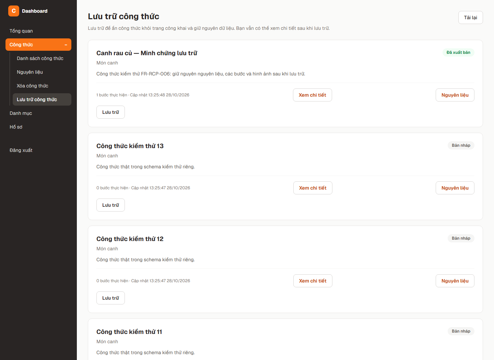
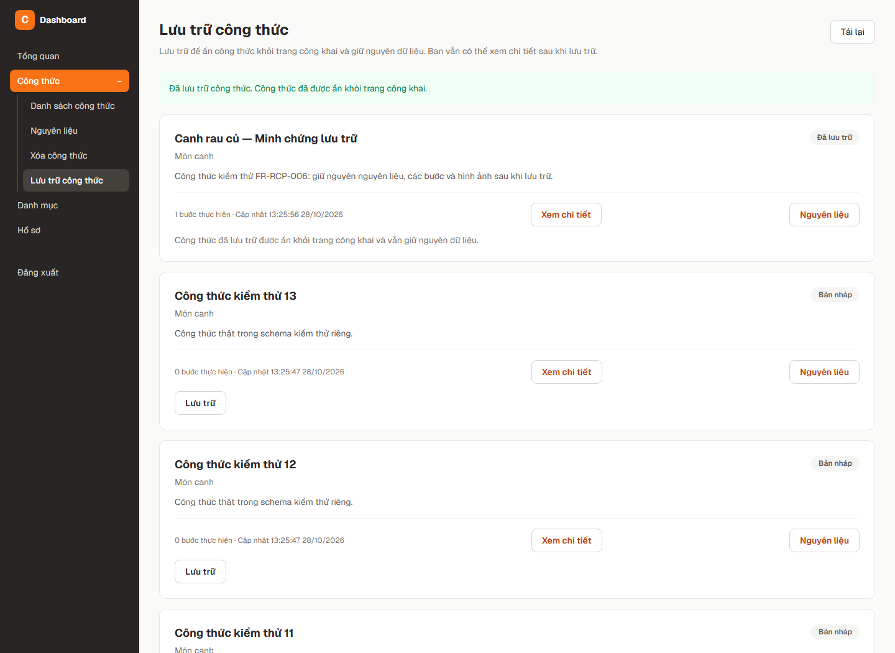
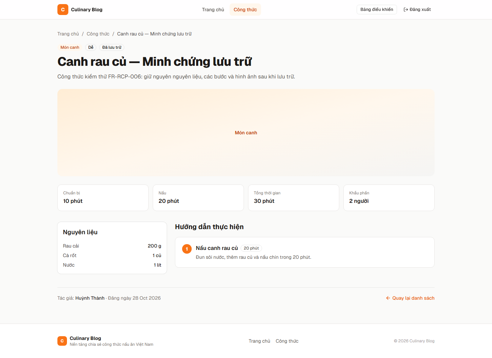
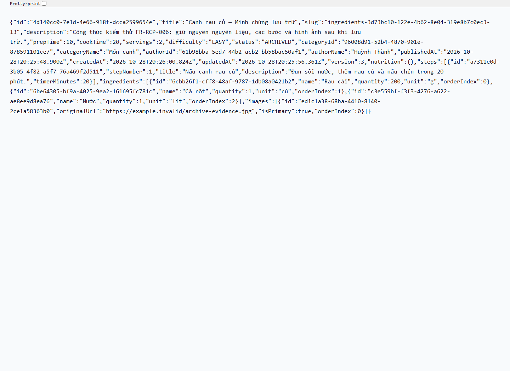
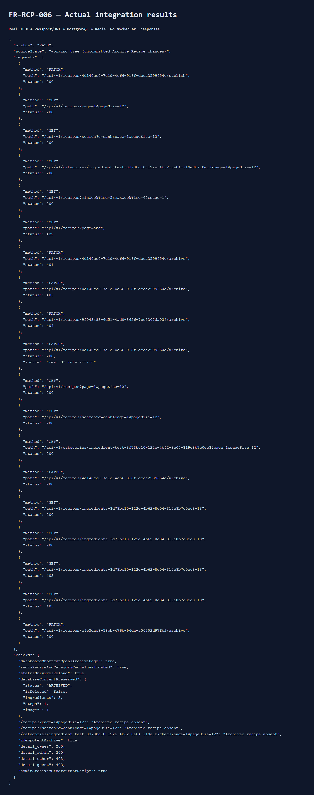
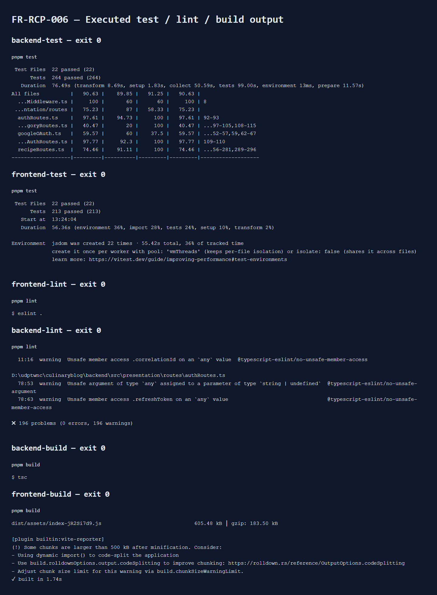

# FR-RCP-006 — Snapshot evidence

Trang Lưu trữ riêng: /dashboard/recipes/archive. Nút truy cập nằm dưới Công thức gần đây trong Dashboard và dưới Xóa công thức trong menu desktop/mobile.

Ảnh từ UI/API thật với PostgreSQL và Redis local; không mock response.

Backend: 264 tests PASS, coverage lines 90.63% (backend không thay đổi). Frontend đã chạy lại: 213 tests PASS, lint/build PASS. Sáu kết quả test/lint/build exit 0; backend lint còn 196 warnings, 0 errors. Schema thử đã được dọn.

## 00-dashboard-shortcut.png

## 01-before-archive.png

## 02-archive-success.png

## 03-owner-archived-detail.png

## 04-live-api-response.png

## 05-http-database-cache-checks.png

## 06-tests-lint-build.png

Dữ liệu gốc: [result.json](result.json), [checks.json](checks.json), [source-manifest.json](source-manifest.json).
