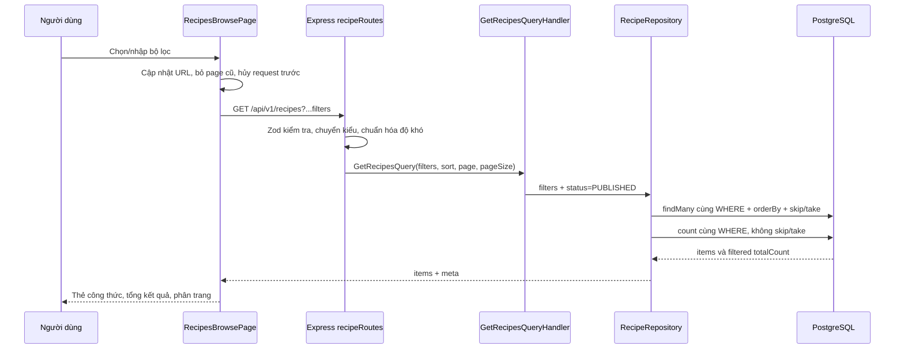

# Issue #35 — FR-SRCH-002: Lọc công thức

Nguồn: [GitHub issue #35](https://github.com/gsb-b60/culinaryblog/issues/35), `docs/03-fr-misc.md` §3.4 và luồng danh sách FR-RCP-001. Số “Issue #27” trong tiêu đề là thứ tự công việc nội bộ; số issue GitHub là **35**.

## 1. Mục tiêu và phạm vi

Khách, tác giả và quản trị viên có thể tìm công thức công khai phù hợp bằng danh mục, độ khó, thời gian nấu tối đa và khẩu phần tối thiểu. Không cần đăng nhập. Kết hợp tất cả điều kiện bằng **AND**, lọc tại PostgreSQL trước phân trang; tổng số bản ghi là tổng sau lọc.

Issue đang mang nhãn blocked bởi hợp đồng danh sách. Tại mã nguồn kiểm tra, `GET /api/v1/recipes` đã có validator, CQRS, repository, phân trang và published-only handler. Vì vậy có thể tích hợp trực tiếp trong workspace; nhãn trên GitHub chưa được cập nhật. Dòng “blocked by #20” dùng số thứ tự nội bộ: bảng README ánh xạ View Recipe List sang GitHub #30, còn GitHub #20 là Update Recipe.

Phạm vi hoàn thiện: bộ lọc API, giao diện `/recipes`, OpenAPI, kiểm thử tự động và E2E. Không mở rộng thuật toán tìm kiếm, sắp xếp hoặc hợp đồng phân trang của các issue khác.

## 2. Phân tích hiện trạng và thay đổi

| Thành phần | Trước khi bổ sung | Sau khi bổ sung |
|---|---|---|
| Danh mục | UUID và điều kiện bằng đã có | Giữ và xác minh dữ liệu trả về |
| Độ khó | Chỉ nhận uppercase enum | Nhận cả Easy/Medium/Hard/Expert theo issue, chuẩn hóa uppercase |
| Thời gian nấu | Đã có `cookTime.lte` | Kiểm tra biên 0, bằng ngưỡng, số sai định dạng và giới hạn PostgreSQL Int |
| Khẩu phần | Chưa có `minServings` xuyên suốt | Validator → filter type → Prisma `servings.gte` |
| AND / count | Cùng where cho findMany và count | Kiểm chứng bằng dữ liệu đối chứng và nhiều trang |
| Giao diện công khai | Danh mục và từ khóa | Thêm độ khó, phút nấu, khẩu phần, xóa lọc, báo dữ liệu sai |
| Tài liệu API | Chưa mô tả đủ bộ lọc | Bổ sung hai tham số số và ngữ nghĩa AND/count |

Không cần migration: `servings`, `cookTime`, `difficulty`, `categoryId` đã tồn tại trong bảng recipes.

## 3. Hợp đồng và quy tắc nghiệp vụ

```http
GET /api/v1/recipes?categoryId={uuid}&difficulty=Easy&maxCookTime=30&minServings=2&page=1&pageSize=12
```

| Tham số | Hợp lệ | Điều kiện |
|---|---|---|
| categoryId | UUID; tùy chọn | `categoryId = giá trị` |
| difficulty | Easy, Medium, Hard, Expert hoặc uppercase tương ứng | `difficulty = enum đã chuẩn hóa` |
| maxCookTime | Số nguyên 0..2147483647; tùy chọn | `cookTime <= giá trị` |
| minServings | Số nguyên 1..2147483647; tùy chọn | `servings >= giá trị` |
| page/pageSize | Theo validator phân trang hiện hữu | Áp dụng sau lọc |

- Bỏ tham số nghĩa là không giới hạn theo tiêu chí đó. Một bộ lọc không xóa bộ lọc khác.
- `maxCookTime` chỉ tính thời gian nấu, không cộng `prepTime`. 0 hợp lệ cho món không cần nấu.
- Hai ngưỡng đều bao gồm giá trị bằng. Khẩu phần không được bằng 0.
- Difficulty viết thường toàn bộ như `easy` không nằm trong hợp đồng hỗ trợ.
- UUID đúng định dạng nhưng không có danh mục tương ứng trả 200 và danh sách rỗng.
- Chỉ trả `PUBLISHED` và `isDeleted=false`, kể cả client gửi `status=DRAFT`.
- Bộ lọc số rỗng, âm, thập phân, chữ, quá giới hạn Int hoặc tham số lặp tạo array: 422.
- Giá trị độ khó không hợp lệ và UUID sai định dạng: 422.
- Không khớp: 200, `items=[]`, `totalCount=0`, `totalPages=0`.
- Truy vấn trang ngoài phạm vi: API trả items rỗng nhưng giữ tổng đã lọc; UI tự điều chỉnh về trang cuối hợp lệ.

Ví dụ kết quả (rút gọn):
```json
{
  "items": [],
  "meta": {
    "page": 1, "pageSize": 12, "totalCount": 0, "totalPages": 0,
    "hasNextPage": false, "hasPreviousPage": false
  }
}
```

422 dùng `application/problem+json`, chứa `status`, `title`, `detail`, `errors` theo tên trường.

## 4. Cách hoạt động từ trình duyệt đến dữ liệu



Prisma dùng các thuộc tính trong cùng đối tượng `where`, tương đương:

```sql
WHERE is_deleted = false
  AND status = 'PUBLISHED'
  AND category_id = :categoryId
  AND difficulty = :difficulty
  AND cook_time <= :maxCookTime
  AND servings >= :minServings
ORDER BY created_at DESC, id ASC
LIMIT :pageSize OFFSET (:page - 1) * :pageSize;
```

Chỉ thêm mệnh đề của tham số được cung cấp. COUNT dùng cùng WHERE, không dùng LIMIT/OFFSET. Tìm theo từ khóa vẫn ghép AND với các tiêu chí trên; OR nội bộ title/description chỉ phục vụ tìm chữ.

`findMany` và `count` chạy song song, chưa nằm trong transaction snapshot: nếu dữ liệu bị sửa đồng thời, hai kết quả có thể chênh lệch tạm thời. Đây là giới hạn hiện hữu, không được coi là bảo đảm snapshot nguyên tử.

## 5. Hành vi giao diện

- Bộ lọc nằm trên trang công khai `/recipes`; danh mục tải từ API thật.
- Độ khó là select; thời gian và khẩu phần là ô số có label, min/max/step.
- URL là nguồn trạng thái: lưu link, tải lại, Back/Forward đều khôi phục bộ lọc.
- Đổi bộ lọc xóa `page` về mặc định 1; phân trang giữ nguyên tiêu chí.
- Giá trị số 0 được gửi lên API, không bị mất do kiểm tra truthy.
- Mỗi bộ lọc tham gia query key. Request cũ bị abort và không được ghi đè dữ liệu mới.
- Từ khóa có debounce 250ms; từ khóa một ký tự có hướng dẫn nhập ít nhất hai ký tự.
- URL chứa bộ lọc mới không hợp lệ hiển thị thông báo; không gửi request danh sách sai.
- Xóa bộ lọc xóa cả danh mục, từ khóa, độ khó, thời gian, khẩu phần và trang.
- Có trạng thái tải, không có kết quả, lỗi tải và thử lại. Danh sách lỗi không được trình bày như thành công rỗng.

## 6. Thiết kế kiểm thử và tiêu chí nghiệm thu

| Ca kiểm thử | Kết quả cần đạt |
|---|---|
| Chỉ categoryId | Chỉ đúng danh mục |
| Mỗi mức difficulty, cả hai cách viết hỗ trợ | Đúng mức; không mất tương thích client |
| maxCookTime=30 | Có món 30 phút, loại món 31 phút; không cộng prepTime |
| maxCookTime=0 | Chỉ món không cần nấu |
| minServings=2 và =4 | Bao gồm đúng ngưỡng, loại nhỏ hơn |
| Ghép cả bốn | Tất cả điều kiện cùng đúng; mỗi món đối chứng sai một điều kiện bị loại |
| 14 món khớp, pageSize=12 | Trang 1 có 12, trang 2 có 2; tổng cả hai là 14, không trùng/mất |
| Trang 3 của 2 trang | Items rỗng, tổng vẫn là 14 |
| Draft, Archived, soft-deleted | Không xuất hiện; không tính vào tổng |
| UUID không tồn tại / không khớp | 200 và rỗng |
| Difficulty sai / số sai / array / quá Int | 422 Problem Details |
| Từ khóa và /recipes/search | Giữ các điều kiện lọc |
| Thao tác bốn control | Request và kết quả đúng; URL đầy đủ |
| Reload / Back / Forward | Trạng thái và kết quả khôi phục |
| Đổi bộ lọc ở trang 2 | Trở về trang 1 |
| Xóa lọc / URL sai / rỗng | Có thể phục hồi và tải lại danh sách |
| Màn hình 390px | Dùng được bộ lọc, không tràn ngang |

Dữ liệu E2E được tạo cố định trong schema PostgreSQL riêng có tên ngẫu nhiên qua helper sẵn có `startIngredientIntegration`. 14 món DRAFT của helper không được tính vào kết quả công khai. Bộ fixture bổ sung có 20 món published hợp lệ và ba món bị ẩn theo trạng thái/xóa. Không seed lại hoặc reset dữ liệu ứng dụng. Schema riêng được dọn trong finally sau kiểm thử.

E2E dùng Express routes, validator, CQRS, Prisma và PostgreSQL thật; Chromium mở Vite thật và gọi HTTP thật. Không route.fulfill, không mock response API. Helper dựng app kiểm thử dùng các route/middleware thật; không chạy toàn bộ process production/Nginx.

## 7. Chạy lại và bằng chứng

Yêu cầu: dependencies backend/frontend đã cài, PostgreSQL và Redis local đang chạy, backend/.env trỏ đúng dịch vụ local, Chromium của Playwright đã cài. Vite kiểm thử dùng 127.0.0.1:5187; API chọn cổng trống tự động. Có thể dùng `INTEGRATION_DATABASE_URL` để chọn PostgreSQL local.

```powershell
cd backend
npx vitest run tests/recipe-filtering.test.ts
npm run test:e2e:filtering
npm run build
cd ../frontend
npm run build
```

File E2E tên `.e2e.ts` chạy riêng bằng script; không tự chạy trong Vitest unit suite.

Bằng chứng sau khi chạy:
- `evidence/fr-srch-002/result.json`: kết quả, danh sách checks, commit nền, trạng thái working tree, lỗi nếu có.
- `evidence/fr-srch-002/desktop.png`: bốn bộ lọc và danh sách desktop.
- `evidence/fr-srch-002/mobile.png`: bộ lọc tại 390px.
- Kết quả validation/build/lint bổ sung được ghi bên dưới khi thực chạy.

Không đánh dấu issue GitHub hoàn tất chỉ dựa trên tài liệu. Nghiệm thu dựa vào kết quả chạy thực tế; các giới hạn hoặc ca chưa chạy phải ghi rõ.

## 8. Kết quả kiểm thử thực tế — 29/10/2026

| Lệnh / kiểm tra | Kết quả |
|---|---|
| Backend: `npx vitest run tests/recipe-filtering.test.ts` | **23/23 passed** |
| Backend: `npm run test:e2e:filtering` | **25 nhóm checks passed**, PostgreSQL thật, Chromium desktop/mobile |
| Backend: `npx vitest run` | **313/313 tests, 25/25 files passed**, gồm real-services integration |
| Frontend: `npx vitest run` | **240/240 tests, 25/25 files passed** |
| Backend: `npm run build` | Passed |
| Frontend: `npm run build` sau thay đổi UI cuối | Passed |
| Backend: `npm run lint` | Exit 0; **0 errors, 196 warnings** |
| Frontend: `npm run lint` | Passed, không có lỗi/cảnh báo |
| `git diff --check` | Passed |

E2E lần cuối hoàn tất cả API và trình duyệt, không có `pageerror`. Hai lần chạy trước giúp phát hiện và sửa label select khó định vị theo trợ năng và nút xóa bị trùng trong trạng thái rỗng. Bằng chứng hiện tại là lần chạy cuối đã pass.

- [Kết quả E2E chi tiết](./evidence/fr-srch-002/result.json)
- [Ảnh desktop](./evidence/fr-srch-002/desktop.png)
- [Ảnh mobile](./evidence/fr-srch-002/mobile.png)
- [Tổng hợp validation](./evidence/fr-srch-002/validation.json)

Các cảnh báo backend lint tập trung vào kiểu `any`, unsafe typing và console trong mã hiện hữu; lint vẫn exit 0. Frontend build có cảnh báo chunk JS lớn hơn 500 kB sau minify, không chặn build. Lần chạy này không đo coverage, tải đồng thời hoặc hiệu năng trên dữ liệu lớn. Chưa triển khai, push hay đóng issue GitHub.

Tất cả 7 acceptance criteria của issue đã được kiểm chứng trong lần E2E cuối: category, 4 mức difficulty, cookTime ≤ ngưỡng, servings ≥ ngưỡng, AND, filtered totalCount và invalid difficulty → 422.

## 9. Các file triển khai và vai trò

| File | Vai trò |
|---|---|
| [recipeValidators.ts](../../../backend/src/application/validators/recipeValidators.ts) | Kiểm tra query, chuẩn hóa difficulty, chuyển kiểu số |
| [IRecipeRepository.ts](../../../backend/src/domain/repositories/IRecipeRepository.ts) | Khai báo minServings xuyên qua application/repository |
| [recipeRoutes.ts](../../../backend/src/presentation/routes/recipeRoutes.ts) | Parse query và dispatch CQRS; sử dụng route hiện có |
| [RecipeQueryHandlers.ts](../../../backend/src/application/handlers/RecipeQueryHandlers.ts) | Ép trạng thái công khai PUBLISHED; sử dụng handler hiện có |
| [RecipeRepository.ts](../../../backend/src/infrastructure/persistence/repositories/RecipeRepository.ts) | Dựng WHERE chung, servings.gte, count và paging |
| [openapi.ts](../../../backend/src/presentation/docs/openapi.ts) | Mô tả hợp đồng bộ lọc và 422 |
| [RecipesBrowsePage.tsx](../../../frontend/src/pages/RecipesBrowsePage.tsx) | Thanh bộ lọc, URL state, request cancellation, render trạng thái |
| [recipe.ts](../../../frontend/src/types/recipe.ts) | Kiểu query có minServings |
| [recipe-filtering.test.ts](../../../backend/tests/recipe-filtering.test.ts) | 23 kiểm thử validation |
| [recipe-filtering.e2e.ts](../../../backend/tests/recipe-filtering.e2e.ts) | Kịch bản HTTP + trình duyệt, dữ liệu thật, ảnh và JSON |
| [ingredientIntegration.ts](../../../backend/tests/support/ingredientIntegration.ts) | Helper dịch vụ thật được dùng lại; bổ sung mount category routes |

## 10. Kiểm tra thủ công khi chạy ứng dụng

1. Khởi động backend và frontend theo README dự án; mở `http://localhost:5173/recipes`.
2. Chọn danh mục, độ khó, nhập 30 phút và khẩu phần 2. Xác nhận URL giữ đủ bốn tham số.
3. Mở DevTools → Network, xem request `GET /api/v1/recipes`; kiểm tra `items` và `meta.totalCount`. Thời gian trên thẻ hiện tổng prep+cook theo thiết kế sẵn có; dùng `cookTime` trong response để đối chiếu bộ lọc.
4. Nếu có nhiều trang, sang trang 2; đổi khẩu phần, xác nhận về trang 1 và tổng thay đổi phù hợp.
5. Tải lại, dùng Back/Forward và mở lại URL đã lưu; xác nhận trạng thái bộ lọc được khôi phục.
6. Nhập ngưỡng khiến không có món phù hợp, rồi bấm Xóa bộ lọc. Sửa URL thành `?minServings=-1` để kiểm tra thông báo lỗi và xóa để phục hồi.
7. Chuyển DevTools sang mobile và kiểm tra các điều khiển. Tắt mạng, đổi bộ lọc để thấy lỗi, bật lại và bấm Thử lại.

Dữ liệu ứng dụng thực tế có thể khác fixture E2E nên không kỳ vọng số món cố định 14/20 ở bước kiểm tra thủ công.
